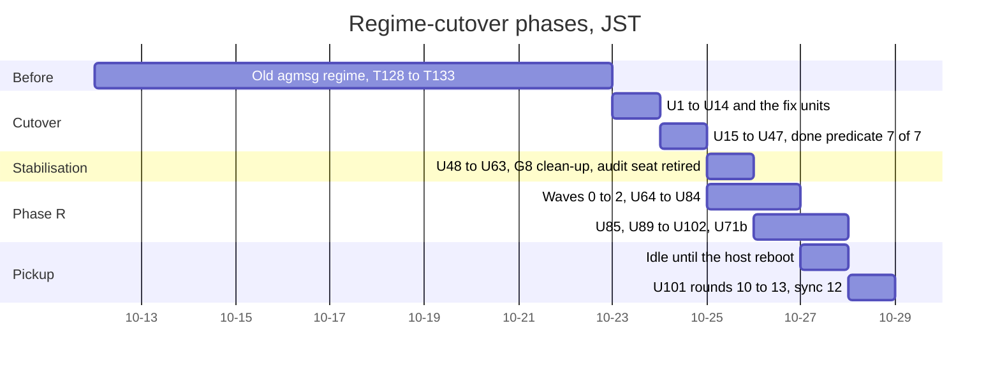
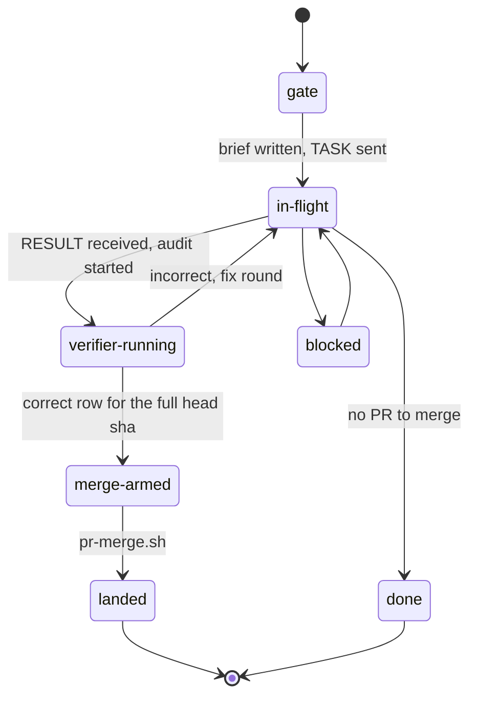

# Regime-cutover program status, 2026-10-28

This file records where the `regime-cutover` program stands after the pickup of 2026-10-28 (JST). Every figure was measured in the coordinator session of that day unless a cell says "inferred". The conventions and the store layout are in the [README](README.md). The analysis of the audit rounds is in [02-audit-treadmill-analysis.md](02-audit-treadmill-analysis.md).

## Program

| Item               | Value                                                                                                          |
| ------------------ | -------------------------------------------------------------------------------------------------------------- |
| Start              | 2026-10-23, store added in commit a8f36e1f at 13:49 JST                                                        |
| Plan               | [.orchestration/plans/025-regime-cutover-plan.md](../../../plans/025-regime-cutover-plan.md), plan 025 v15     |
| Store              | `.orchestration/orchestrate/regime-cutover/`                                                                   |
| Checkout           | `~/Workspace/dotfiles` on `main`, converged on origin/main 65f630b6 after the pickup                           |
| Deployed on macOS  | 590db689, `make update` exit code 0, `make doctor` tools passed and runtime passed with the C6 and C7 warnings |
| Deployed on Ubuntu | 81c74922 on `<ubuntu-host>`, without `srt` and `rg`                                                            |

## Timeline

All times are JST. An `x` in a time stands for a minute digit the coordinator did not record.

| When                       | What                                                                                                                                                                                                                                                                           | Evidence                                                                                     |
| -------------------------- | ------------------------------------------------------------------------------------------------------------------------------------------------------------------------------------------------------------------------------------------------------------------------------ | -------------------------------------------------------------------------------------------- |
| 10-12 to 10-22             | The old agmsg regime, tasks T128 to T133. 106 untracked `.orchestration/dotfiles-T1*` directories and about 100 untracked `.orchestration/validation/dotfiles-T1*` files still sit in the coordinator checkout. The program never touched them.                                | `git status --short` in the checkout                                                         |
| 10-23 10:05 to 23:06       | Cutover. Units U1 to U14 and the fix units U6b, U6c, U6d, U7c, U9b, U9c, U9d, U10b and U14b. The X cutover steps passed at 19:56.                                                                                                                                              | [gates.md](../gates.md) G4                                                                   |
| 10-24                      | After the cutover, U15 to U47 through omp worker seats. U44 measured the plan-025 done predicate at 7 of 7 at about 22:3x. From about 23:3x the audit seat's SIWC route returned a usage-limit error and audits moved to `codex exec`.                                         | [overview.md](../overview.md) "Done predicate, measured", [gates.md](../gates.md) G9         |
| 10-25 08:25 to 16:02       | Stabilisation, U48 to U63. The G8 clean-up was executed. The hcom audit seat was retired by U57 and U58.                                                                                                                                                                       | [gates.md](../gates.md) G8, [units.tsv](../units.tsv) U57 and U58                            |
| 10-25 17:08 to 10-26 05:17 | Phase R waves 0 to 2, U64 to U84, covering the 199 findings F001 to F199 of the be179c71 audit.                                                                                                                                                                                | [phase-r-plan.md](../phase-r-plan.md), [phase-r-assignments.tsv](../phase-r-assignments.tsv) |
| 10-26 04:44                | Operator decisions G10, G11, G17 and G18.                                                                                                                                                                                                                                      | [decisions.tsv](../decisions.tsv) rows `G10-done`, `G11-done`, `G17-decided`, `G18-decided`  |
| 10-26 10:24 to 10-27 03:30 | U85, U89 to U102 and U71b.                                                                                                                                                                                                                                                     | [units.tsv](../units.tsv)                                                                    |
| 10-27 03:37 to 03:50       | U101 round 9 pushed as 69424666. Its `validate` check was red. No activity followed until the host rebooted on 10-28 at 07:48.                                                                                                                                                 | [ledger.tsv](../ledger.tsv) U101 rows, PR #574                                               |
| 10-28 08:4x to 11:0x       | This pickup. U101 rounds 10 to 13, merged as 590db689 (PR #574). Records sync 12 merged as 65f630b6 (PR #576). macOS deployed at 590db689. The coordinator checkout converged on origin/main. 349 stale worktree registrations were pruned, 366 to 17, with every branch kept. | [ledger.tsv](../ledger.tsv) rows of 2026-10-28, `git worktree list`                          |



The gantt rounds every phase to whole days. The table above holds the measured times.

## Unit states

The counts come from this command, run in the store after the pickup:

```sh
awk -F'\t' 'NR>1{c[$3]++}END{for(s in c)print s,c[s]}' units.tsv
```

| State     | Count | Units                             |
| --------- | ----- | --------------------------------- |
| landed    | 107   | every other unit                  |
| done      | 4     | U1, U11, U12, U19                 |
| gate      | 2     | U23, U24                          |
| planned   | 1     | U88                               |
| abandoned | 1     | U86, folded into U85              |
| total     | 115   | rows in [units.tsv](../units.tsv) |

The unit life cycle, from the "Rows" section of [home/dot_agents/skills/hcom-orchestration/SKILL.md](../../../../home/dot_agents/skills/hcom-orchestration/SKILL.md):



The SKILL lists the seven state names and the order `gate`, `in-flight`, `verifier-running`, `merge-armed`, `landed`, `blocked`, `done`. The arrows into and out of `blocked` and `done` are inferred from the rows of [units.tsv](../units.tsv), not stated by the SKILL.

## Phase R done predicate

The predicate is the "Done predicate" section of [phase-r-plan.md](../phase-r-plan.md). Measured 2026-10-28:

| Clause | Text                                                            | State      | Evidence                                                                                                                                                                                |
| ------ | --------------------------------------------------------------- | ---------- | --------------------------------------------------------------------------------------------------------------------------------------------------------------------------------------- |
| 1      | Every finding F001 to F199 is closed by a landed unit or parked | true       | [phase-r-assignments.tsv](../phase-r-assignments.tsv) joined with [units.tsv](../units.tsv). The parked P3 findings F074, F149 and F170 have rows in [decisions.tsv](../decisions.tsv). |
| 2      | U64 to U85 all landed                                           | true       | [units.tsv](../units.tsv). U86 was folded into U85.                                                                                                                                     |
| 3      | Both hosts run the merged head                                  | macOS only | macOS runs 590db689. `<ubuntu-host>` is at 81c74922 without `srt` and `rg`, so every seat launch there refuses after U85. [phase-r-issues.md](../phase-r-issues.md) C3.                 |
| 4      | The drift watch ran on schedule                                 | true       | Run of 2026-10-26 01:45Z with success, `gh run list --workflow drift-watch`.                                                                                                            |

## U101 record

U101 is PR #574, 13 rounds. Rounds 1 to 9 were run by the prior coordinator on 2026-10-26. Their design, from the decisions row `treadmill-u101-config-free`, is a copy set against origin/main, no `--validation`, identity by `GIT_AUTHOR_*` and `GIT_COMMITTER_*`, hooks never run, and a config-less scratch repository. Rounds 10 to 13 were run by this pickup.

| Round | Head     | What the round found and changed                                                                                                                                                                                                                                                                                                                                                                                                                                                                                     |
| ----- | -------- | -------------------------------------------------------------------------------------------------------------------------------------------------------------------------------------------------------------------------------------------------------------------------------------------------------------------------------------------------------------------------------------------------------------------------------------------------------------------------------------------------------------------- |
| 10    | 0c7bf092 | The `validate` red was the committed-secret scan's generic rule matching an assignment of a quoted string to a test variable named `token` in `tests/unit/test_pr_levers.py`. The fixture is now named `planted`, as the file's other fixtures are. Codex P1 4379614437 fixed. The identity read with `git config --get` keeps its exit status. Exit 1 (unset) is refused, any other status is a failure that names the status, and an empty value is refused. A failure-injection test uses `FAKE_GIT_FAIL_STATUS`. |
| 11    | 7b3c2718 | Audit P2. An unreadable store directory makes `git ls-files` warn and exit 0, so its files leave the listing and are pushed as deletions. Closed by a `find` walk written to a scratch file, a read-and-search check per directory, and a refusal on any stderr of the listing. Audit P2. The origin URL read conflated a failed `git config` with unset. Closed by the same reader, `read_config <git function> <key> <variable>`.                                                                                  |
| 12    | 37ade6dc | Audit P2. A `core.fsmonitor` hook of the checkout runs inside `git ls-files`. Closed with `-c core.fsmonitor=false -c core.hooksPath=/dev/null` on the listing. Audit `correct`. CI `validate` red on a second file, `tests/unit/test_validate_agent_assets.py`, with the same fixture-name cause. It was hidden until then because the scan stops at its first hit.                                                                                                                                                 |
| 13    | efafe11f | The two fixtures renamed. `validate_no_obvious_secrets()` run over the whole tree is clean. Audit `correct`, [verdicts/U101-efafe11f.md](../verdicts/U101-efafe11f.md). CI 12 checks pass, CodeRabbit skipping. `pr-threads-check.sh` reports 3 of 3 `fixed`. Merged by `pr-merge.sh` with the receipt `merged pr=574 head=efafe11f... commit=590db689... verdict=2026-10-28T00:55:00Z`.                                                                                                                             |

Ledger rows written for U101 in this pickup:

| Row ts (UTC)           | Head     | Verdict   |
| ---------------------- | -------- | --------- |
| `2026-10-28T00:03:00Z` | 0c7bf092 | incorrect |
| `2026-10-28T00:15:00Z` | 7b3c2718 | incorrect |
| `2026-10-28T00:35:00Z` | 37ade6dc | ci-red    |
| `2026-10-28T00:40:00Z` | 37ade6dc | correct   |
| `2026-10-28T00:55:00Z` | efafe11f | correct   |

PR #574 is at <https://github.com/mryfmo/dotfiles/pull/574>.

## Records sync 12

| Item                  | Value                                                                                                                                                                                                                                                                       |
| --------------------- | --------------------------------------------------------------------------------------------------------------------------------------------------------------------------------------------------------------------------------------------------------------------------- |
| PR                    | #576, <https://github.com/mryfmo/dotfiles/pull/576>                                                                                                                                                                                                                         |
| Head                  | 9b87dc49, merged as 65f630b6                                                                                                                                                                                                                                                |
| Files                 | 12, all under the store                                                                                                                                                                                                                                                     |
| Difference from local | One masked word in the coordinator's own decisions row of `2026-10-27T23:55:05Z`.                                                                                                                                                                                           |
| Audit                 | `pr-audit.sh` refused the PR because the body that `records-sync.sh` writes has no `## Contract` section. The ledger row of `2026-10-28T01:50:00Z` holds the orchestrator verdict, the form used for every records PR so far (the U20 rows in [ledger.tsv](../ledger.tsv)). |

The missing section is the subject of spec R3 in [03-remediation-spec.md](03-remediation-spec.md).
