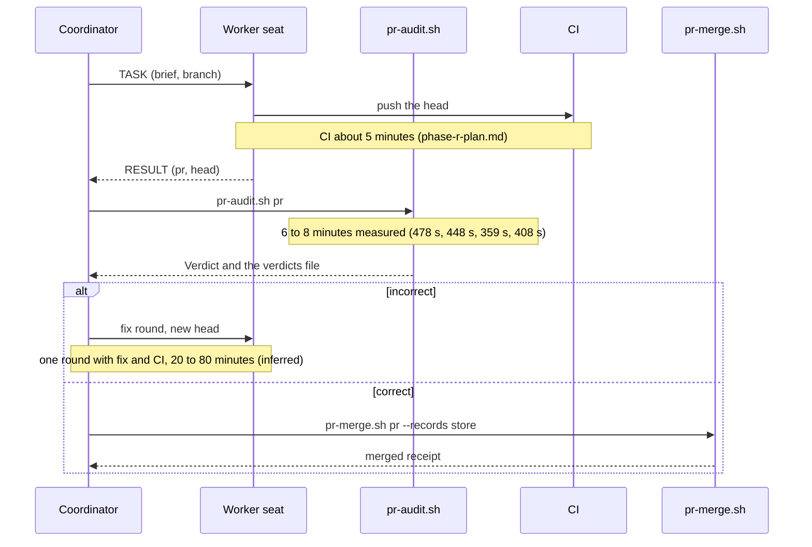
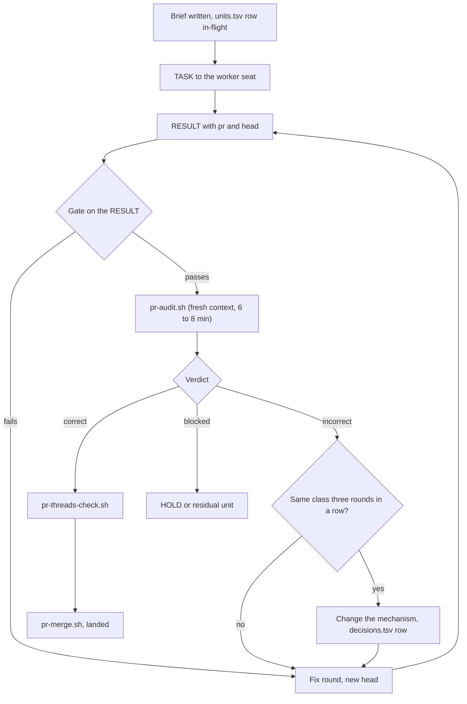

# Why the audit round set the pace of regime-cutover

This file answers one bounded question. Why did the audit round, and not building or CI, set the program's pace, and what was it about the units that needed ten or more rounds? The figures come from the store as measured on 2026-10-28 (JST). A figure marked "inferred" was derived from store rows, not measured in a controlled run. The options at the end are the coordinator's judgment and are labelled as such. The specs that act on them are in [03-remediation-spec.md](03-remediation-spec.md).

## What the plan predicted

The "Bottleneck and pacing" section of [phase-r-plan.md](../phase-r-plan.md) already named the audit round as the limit. It budgets 5 to 10 minutes per round, 3 to 7 rounds on a trust-boundary unit, and about 5 minutes for CI. The plan was right about the unit of cost and wrong about the count. Several units went far past 7 rounds.

## What the ledger measured

### Rounds per unit

The rounds were counted from the `round N` text in the verdict column of [ledger.tsv](../ledger.tsv). That wording exists only from 2026-10-25. Earlier units are counted by their `incorrect` rows, which is a lower bound.

| Unit | Rounds | Counting method  |
| ---- | ------ | ---------------- |
| U85  | 30     | `round N` text   |
| U73  | 29     | `round N` text   |
| U71b | 23     | `round N` text   |
| U95  | 19     | `round N` text   |
| U101 | 13     | `round N` text   |
| U92  | 12     | `round N` text   |
| U71  | 11     | `round N` text   |
| U81  | 11     | `round N` text   |
| U75  | 10     | `round N` text   |
| U91  | 10     | `round N` text   |
| U96  | 10     | `round N` text   |
| U68  | 9      | `round N` text   |
| U76  | 9      | `round N` text   |
| U97  | 8      | `round N` text   |
| U99  | 8      | `round N` text   |
| U72  | 7      | `round N` text   |
| U78  | 7      | `round N` text   |
| U87  | 7      | `round N` text   |
| U61  | 7      | `round N` text   |
| U62  | 7      | `round N` text   |
| U83  | 6      | `round N` text   |
| U60  | 5      | `round N` text   |
| U69  | 5      | `round N` text   |
| U89  | 5      | `round N` text   |
| U57  | 4      | `round N` text   |
| U74  | 4      | `round N` text   |
| U38b | 5      | `incorrect` rows |
| U56  | 4      | `incorrect` rows |
| U57  | 3      | `incorrect` rows |
| U36  | 3      | `incorrect` rows |

U57 appears twice because both counting methods apply to it and they disagree by one.

### Wall time

| Unit | Rounds | Wall time from brief to landed | Label    |
| ---- | ------ | ------------------------------ | -------- |
| U85  | 30     | about 17 hours                 | inferred |
| U71b | 23     | about 30 hours                 | inferred |
| U73  | 29     | about 11 hours                 | inferred |

One round with its fix and its CI run costs 20 to 80 minutes at the unit level (inferred). Each `pr-audit.sh` run in this pickup took 6 to 8 minutes. The four measured runs took 478 s, 448 s, 359 s and 408 s.

### One round

## The round loop and where it stalls

The loop has one exit for a `correct` verdict and one branch, the treadmill rule, that changes the approach. Every unit in the table with ten or more rounds spent most of its rounds cycling through `fix` and `result` before that branch was taken.

## The 13 rows that changed an approach

[decisions.tsv](../decisions.tsv) holds 13 rows of class `treadmill` or `premise`. Each names an open-ended input that a hand-written check was judging, and the mechanism that ended the run.

| Row ts (UTC)           | Row                          | Unit | What was being judged by hand                  | What ended the run                                                                                                    |
| ---------------------- | ---------------------------- | ---- | ---------------------------------------------- | --------------------------------------------------------------------------------------------------------------------- |
| `2026-10-24T23:25:00Z` | premise                      | U38b | dirname spellings                              | the rule became name-independent, every nested command substitution refused                                           |
| `2026-10-25T04:19:00Z` | premise                      | U56  | check-then-remove races                        | quarantine by rename, delete in a later purge                                                                         |
| `2026-10-25T07:02:21Z` | premise                      | U62  | token lint against line lint                   | findings are the main line rules union the token rules                                                                |
| `2026-10-25T15:10:48Z` | `treadmill-u76-enforce-uv`   | U76  | a hand-written bash splitter                   | an shfmt AST walk                                                                                                     |
| `2026-10-25T15:10:48Z` | `treadmill-u73-probes`       | U73  | absent against cannot-tell, malformed records  | one strict parser module, [scripts/pin_records.py](../../../../scripts/pin_records.py)                                |
| `2026-10-25T21:08:58Z` | `treadmill-u89-exclude`      | U89  | name exemptions that reach unverified versions | no exemption                                                                                                          |
| `2026-10-26T00:31:07Z` | `treadmill-u71b-supervisor`  | U71b | bash and perl process supervision              | one Python supervisor                                                                                                 |
| `2026-10-26T04:52:54Z` | `treadmill-u96-fallback`     | U96  | the fallback hand-over                         | removed                                                                                                               |
| `2026-10-26T05:28:16Z` | `treadmill-u95-nested-shape` | U95  | nested worktree admission                      | an exact-shape allowlist, then refusal by the operator decision `U95-nested-refuse-decided` of `2026-10-26T08:28:20Z` |
| `2026-10-26T09:09:42Z` | `treadmill-u97-classify`     | U97  | filesystem heuristics                          | git index modes and a closed shebang table                                                                            |
| `2026-10-26T10:03:41Z` | `premise-u99-supervisor`     | U99  | descendant clean-up in the bats wrapper        | removed, CI timeouts are the stop                                                                                     |
| `2026-10-26T10:31:15Z` | `treadmill-u99-scanner`      | U99  | a shell tokenizer for curl and wget            | an exact-form allowlist plus an exemption table                                                                       |
| `2026-10-26T18:37:19Z` | `treadmill-u101-config-free` | U101 | the checkout's git config channels             | a config-less scratch repository                                                                                      |

## The root cause

The 13 rows share one shape. An open-ended input was judged by a hand-written parser, supervisor or heuristic. The inputs were shell text, a process tree, git state or configuration, a worktree or file-system shape, or a path name. A fresh-context auditor found one more way past the check each round. The round that ended the run always changed the mechanism rather than the enumeration. The replacements were an AST walk, one strict parser module, a closed allowlist, or removing the feature.

In every one of the 13 cases that change came after three or more rounds, and never at brief time. Standing order 33 in [preferences.md](../preferences.md) and the treadmill rule in the "Gates" section of [home/dot_agents/skills/hcom-orchestration/SKILL.md](../../../../home/dot_agents/skills/hcom-orchestration/SKILL.md) both fire after three consecutive rounds of the same class. Both rules therefore apply only after the fact. They cap the damage of a hand-written check. They do not stop a brief from asking for one.

This is why building and CI did not set the pace. A build or a CI run costs the same whether the check is hand-written or not. An audit round costs one more round for every way past the check that the auditor finds, and a hand-written check over an open-ended input has an unbounded number of them.

## The second class, a failed read treated as an absence

Standing order 21, fail closed on every producer, names the other recurring class. U25 F1, U25d F4, Codex finding 4379614437, and the two U101 round-11 findings are all the same defect. A read of a producer failed, and the guard treated the failure as an absence. It is the treadmill class seen from the other side. A guard that reads a producer without its status is a hand-written judgement of an open-ended input, the producer's failure modes.

## Secondary causes

Two other causes added rounds without being the root.

- The audit model's capacity. The audit seat's SIWC route returned a usage-limit error from 2026-10-24 and audits moved to `codex exec`. See [gates.md](../gates.md) G9 and [phase-r-issues.md](../phase-r-issues.md) B6.
- The per-head verdict rule. Every head of a unit gets its own fresh audit, including a merge of `main` and a formatting commit. [ledger.tsv](../ledger.tsv) rows such as U75 round 10 "merge of U74" and U72 round 7 "merges of U81 and U75" are rounds that bought no new finding.

## U101, the latest instance

U101 shows the shape in one unit. Rounds 2 to 7 each closed one more git configuration channel. The channels were the includeIf URL rewrite, author and committer config, hooks, and clean filters. Round 9 removed the sync worktree. Rounds 10 to 12 then found three more instances of the fail-closed class and one more hook channel, `core.fsmonitor`, in the one index read left in the checkout. The round-by-round record is in [01-program-status.md](01-program-status.md).

## Options

The options below are the coordinator's judgment, not a measurement.

| Option | Change                                                                             | What it does to the round count                                                             | Weakness                                                                            |
| ------ | ---------------------------------------------------------------------------------- | ------------------------------------------------------------------------------------------- | ----------------------------------------------------------------------------------- |
| A      | A brief-time closure check. Each brief names the closing mechanism before round 1. | Removes the rounds spent enumerating. The 13 rows show the mechanism was always found late. | A brief can name a mechanism and the worker can still enumerate.                    |
| B      | A two-strike treadmill rule.                                                       | Saves at least one round on each of the 13 units (inferred from the rows).                  | Changes a gate rule, so the operator decides it.                                    |
| C      | Wider gate tiers, so a P2 on a non-boundary unit can move to a residual unit.      | Ends a run earlier on units outside a trust boundary.                                       | Moves work rather than removing it.                                                 |
| D      | More concurrent units.                                                             | Hides the round count behind parallelism.                                                   | Weak. 8 units are already in flight and the next limit is the coordinator's drains. |

The recommendation is A plus B. They remove the cause of the rounds instead of adding capacity. C is a fallback for the units A and B do not reach. D does not address the cause. The specs for A and B are R1 and R2 in [03-remediation-spec.md](03-remediation-spec.md).
