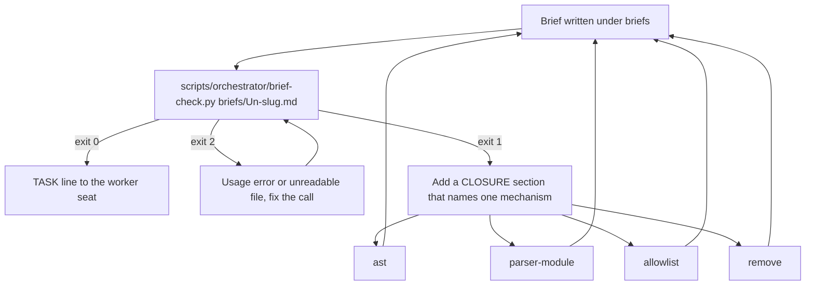

# How to adopt the remediation units

These are proposals. The operator adopts one by giving it a unit id and a row in [units.tsv](../units.tsv). Each spec is written in the brief grammar of the [README](README.md), so the adopting coordinator copies it into `briefs/U<n>-<slug>.md` and changes only the id. Each proposal is its own unit and its own PR, verified before the next, because [phase-r-plan.md](../phase-r-plan.md) requires one contract per unit. The reasoning behind R1 and R2 is in [02-audit-treadmill-analysis.md](02-audit-treadmill-analysis.md). The open items these specs close are in [04-open-items.md](04-open-items.md).

Each spec leaves TIMEBOX to the adopting coordinator. REPORT and STANDING follow the model brief, [briefs/U46-dead-uninstall-functions-removed.md](../briefs/U46-dead-uninstall-functions-removed.md). Paths in SCOPE are relative to the repository root unless they name a store file.

## Adopt a spec

1. Pick the next free `U<n>` in [units.tsv](../units.tsv) and add its row with `state=in-flight`.
2. Copy the spec below into `briefs/U<n>-<slug>.md`. Replace the spec id with the unit id. Fill TIMEBOX.
3. If the spec says the operator decides, wait for the [gates.md](../gates.md) row before sending the TASK.
4. Send the TASK line, run the audit rounds, and merge with `pr-merge.sh` as the [README](README.md) levers describe.
5. Run the next records sync so the store carries the new rows.

## R1, brief-time closure check (option A)

GOAL
A brief whose unit judges an open-ended input names, before round 1, the mechanism that closes it. The check is a script, not a sentence, so it runs on every brief.

SCOPE
New `scripts/orchestrator/brief-check.py`. New `tests/unit/test_brief_check.py`. [home/dot_agents/skills/hcom-orchestration/SKILL.md](../../../../home/dot_agents/skills/hcom-orchestration/SKILL.md) step 1, one sentence that names the script. [scripts/orchestrator/README.md](../../../../scripts/orchestrator/README.md), one row. Nothing else.

CHANGE

1. The script reads one brief file and exits 0, 1 or 2. It exits 2 on a usage error or an unreadable file. It exits 1 when the brief's GOAL, CHANGE or CONTEXT text holds any trigger term and the brief has no `CLOSURE` section, or has one that does not name exactly one of four mechanisms. The mechanisms are `ast` (a parser the language owns, such as `shfmt --to-json` or Python `ast`), `parser-module` (one strict parser module with error defaults), `allowlist` (an exact-form allowlist with an explicit exemption table) and `remove` (the feature that leaks is removed). The trigger terms are a table in the script, one term per row, so a later unit adds a term by adding a row. The terms are shell, tokenize, parse, regex, hook, worktree, config, path, process, signal, supervisor, curl, wget, heredoc and quote.
2. The tests. Each trigger term alone makes a brief without CLOSURE exit 1. A brief with each of the four mechanisms exits 0. A CLOSURE naming two mechanisms or an unknown word exits 1. A brief with no trigger term and no CLOSURE exits 0. An unreadable file exits 2.
3. SKILL step 1 gains this sentence. "Run `scripts/orchestrator/brief-check.py briefs/U<n>-<slug>.md` and send no TASK while it exits non-zero."
4. The README row.

ACCEPTANCE

1. The tests pass in CI.
2. The script run over every existing brief in `briefs/` prints its exit code per file in the PR body. Most existing briefs will exit 1. That table is the evidence that the rule would have fired, not a thing to fix in this unit.
3. `make render-check` unchanged, since no manifest changes.
4. ShellCheck is not involved. The script is Python.

VERIFY

```sh
uv run --no-project python -m unittest tests.unit.test_brief_check
for f in .orchestration/orchestrate/regime-cutover/briefs/*.md
do
	scripts/orchestrator/brief-check.py "$f"
	echo "$f $?"
done
```

FORBIDDEN
No edit to any existing brief. No change to [preferences.md](../preferences.md).

REPORT
Per STANDING 12 plus the RESULT line (standing order 23).

STANDING
[preferences.md](../preferences.md).

The gate this unit adds, between a written brief and the TASK line:



## R2, two-strike treadmill rule (option B)

The operator decides this unit because it changes a gate rule. The unit waits for a [gates.md](../gates.md) row.

GOAL
The treadmill rule fires after two consecutive rounds of one defect class, not three.

SCOPE
[home/dot_agents/skills/hcom-orchestration/SKILL.md](../../../../home/dot_agents/skills/hcom-orchestration/SKILL.md) "Gates", the treadmill bullet. The word "three" and the example sentence stay consistent with each other. `tests/unit/test_hcom_seat_skills.py` if it pins that sentence. Check with `grep -n "three consecutive" tests/unit/`. On 2026-10-28 that grep printed nothing, so no test pinned the sentence on that day. A [decisions.tsv](../decisions.tsv) row by the coordinator naming the change and its basis.

CHANGE

1. Change the count in the treadmill bullet from three to two and keep the example sentence consistent.
2. If the grep finds a pinned sentence, change the test in the same commit.
3. Write the decisions row.

Basis to cite in the PR body. In the 13 treadmill and premise rows listed in [02-audit-treadmill-analysis.md](02-audit-treadmill-analysis.md), the round that changed the approach came after three or more same-class rounds. Under a two-strike rule each of those units saves at least one round. This is inferred from the rows, not measured in a controlled run.

ACCEPTANCE

1. The SKILL sentence and its pinned test, if any, agree.
2. The records sync carries the decisions row.

VERIFY

```sh
grep -n "consecutive" home/dot_agents/skills/hcom-orchestration/SKILL.md tests/unit/test_hcom_seat_skills.py
```

FORBIDDEN
No change to any other bullet of "Gates". No change to `preferences.md` beyond the row the operator's words require.

REPORT
Per STANDING 12 plus the RESULT line (standing order 23).

STANDING
[preferences.md](../preferences.md).

## R3, a Contract section in the records sync body

GOAL
`pr-audit.sh` audits records PRs instead of refusing them.

SCOPE
[scripts/orchestrator/records-sync.sh](../../../../scripts/orchestrator/records-sync.sh), the `printf` block that writes the body, lines 510 to 516 at 65f630b6. [tests/unit/test_pr_levers.py](../../../../tests/unit/test_pr_levers.py), either `RecordsSyncTest.test_the_body_names_the_units_and_decisions` or a new test that asserts the section. [home/dot_agents/agent-config.yaml](../../../../home/dot_agents/agent-config.yaml), [scripts/generated-agent-outputs.json](../../../../scripts/generated-agent-outputs.json) and [home/dot_local/bin/common/executable_records-sync.sh](../../../../home/dot_local/bin/common/executable_records-sync.sh), regenerated through the generator and never edited by hand. [scripts/orchestrator/README.md](../../../../scripts/orchestrator/README.md), the body description.

CHANGE

1. The body gains a `## Contract` section after Summary. Its bullets are these guarantees. The changed paths are exactly the files of `.orchestration/orchestrate/<program>/` that differ from origin/main, whether added, changed or deleted. No path lies outside that directory. Every copy was masked with `--mask-secrets` and passed `--scan-identifiers` with the program's `redact-words.txt`. The commit was built in a config-less repository and pushed over https with no user configuration. The section also says what the sync leaves out. The content of the records is not reviewed for truth, only for the identifier scan.
2. Regenerate the three derived files.

```sh
uv run --no-project --with pyyaml scripts/generate-agent-configs.py
```

3. Update the body description in the README.

ACCEPTANCE

1. The new test fails before the change and passes after it.
2. `pr-audit.sh <next records PR>` runs instead of refusing. This is measured on the first sync after the unit lands.
3. `cmp scripts/orchestrator/records-sync.sh home/dot_local/bin/common/executable_records-sync.sh` reports no difference.
4. CI green.

VERIFY

```sh
uv run --no-project --with pyyaml python -m unittest tests.unit.test_pr_levers.RecordsSyncTest tests.unit.test_scratch_git
shellcheck scripts/orchestrator/records-sync.sh
shfmt -i 4 -sr -d scripts/orchestrator/records-sync.sh
scripts/ci/masked-dirname-check.sh scripts/orchestrator/records-sync.sh
scripts/ci/run-on-lint-files.sh python ruff format --config ruff.toml --check
```

ShellCheck is version 0.11.0.

FORBIDDEN
No hand edit to a generated file. No change to what the sync copies or masks.

REPORT
Per STANDING 12 plus the RESULT line (standing order 23).

STANDING
[preferences.md](../preferences.md).

## R4, store maintenance by the coordinator

R4 is not a unit and opens no PR beyond the next records sync. The coordinator edits the store files directly.

1. In [preferences.md](../preferences.md), extend standing order 19. The `pushInsteadOf` override applies only to an https `remote.origin.url`. When origin is an SSH URL, the push is the command below. Measured 2026-10-28, the override alone was refused with "Permission denied (publickey)".

```sh
GIT_CONFIG_GLOBAL=/dev/null GIT_CONFIG_NOSYSTEM=1 git -c credential.helper= -c 'credential.helper=!gh auth git-credential' push https://github.com/mryfmo/dotfiles.git HEAD:refs/heads/<branch>
```

2. In [ledger.tsv](../ledger.tsv), keep the convention that a verdict row that arms a merge carries the full 40-hex head sha. `pr-merge.sh` matches the full sha only. The pickup first wrote a short sha and had to correct the row.
3. In [decisions.tsv](../decisions.tsv), lines 198 to 214 hold 17 rows with 3 fields instead of 6. Their timestamps run from `2026-10-25T14:53:40Z` to `2026-10-26T18:37:19Z`. They pre-exist on origin/main. Either leave them or repair them in one row-only change. Say which in a decisions row.

## R5, the local checkout residue

R5 is an operator or coordinator decision. Record it in a decisions row before acting.

The coordinator checkout holds 106 untracked `.orchestration/dotfiles-T1*` directories and about 100 untracked `.orchestration/validation/dotfiles-T1*` files from the retired regime of 2026-10-12 to 2026-10-22. None is read by the program.

1. Write a decisions row that chooses archive or keep. G8 chose archive for the worktrees, into `~/.local/state/dotfiles-archive/`.
2. If the row chooses archive, the move is an operator step under standing order 30. Deletion is likewise an operator step.
3. Carry the row in the next records sync.
