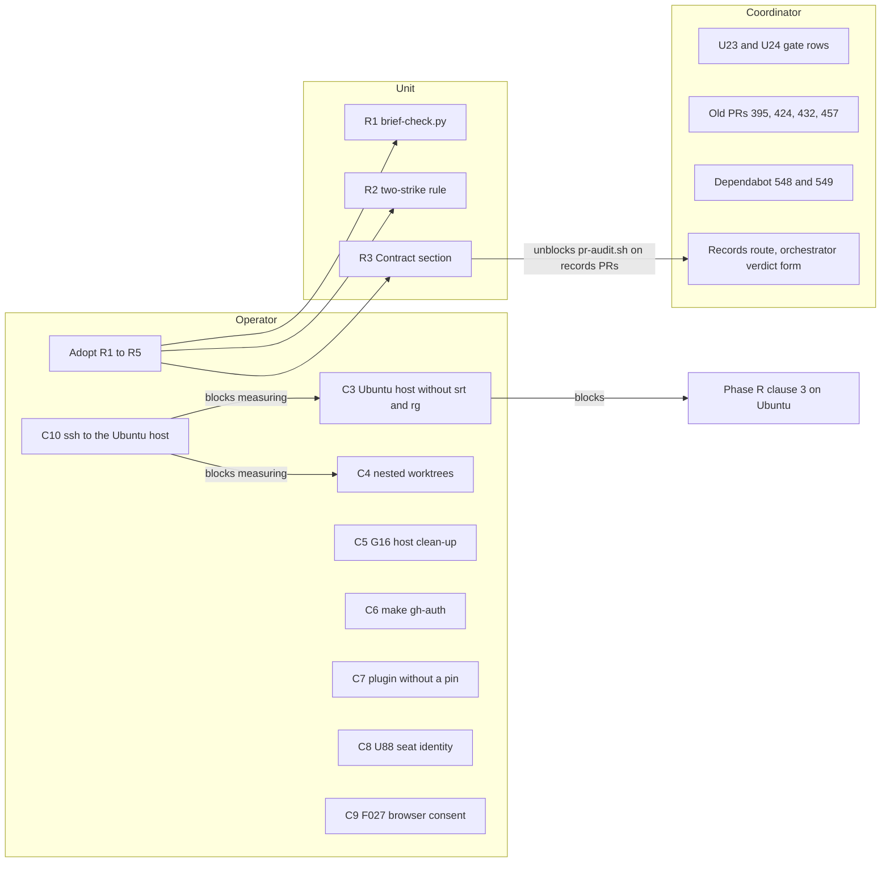

# Regime-cutover open items, 2026-10-28

This file lists every item that stayed open after the pickup of 2026-10-28 (JST). The owner column names who acts. "operator" is the person who runs the hosts, "coordinator" is the orchestrator session, and "unit" means a brief and a PR. The "default" column states what stays true if nobody acts. The specs R1 to R5 are in [03-remediation-spec.md](03-remediation-spec.md). The measured state behind each item is in [01-program-status.md](01-program-status.md).

## Items

| Id    | Item                                                                                                                                                                                            | Owner                                                     | Blocked by                                                  | Default if nothing happens                                                 | Source row                                                                                                              |
| ----- | ----------------------------------------------------------------------------------------------------------------------------------------------------------------------------------------------- | --------------------------------------------------------- | ----------------------------------------------------------- | -------------------------------------------------------------------------- | ----------------------------------------------------------------------------------------------------------------------- |
| C3    | `<ubuntu-host>` is at 81c74922 without `srt` and `rg`. Every seat launch there refuses. The fix is `sudo make update` in `~/.local/share/chezmoi`, then `make doctor`.                          | operator                                                  | C10 for measuring it from the agent                         | Phase R clause 3 stays "macOS only". No seat runs on the Ubuntu host.      | [phase-r-issues.md](../phase-r-issues.md) C3, [handouts/phase-r-operator.md](../handouts/phase-r-operator.md) section 4 |
| C4    | Nested worktrees inside the checkouts. 10 on macOS under `.claude/worktrees`, 8 of them quarantined. 5 on `<ubuntu-host>`.                                                                      | operator                                                  | C10 for measuring the Ubuntu count                          | The worktrees stay as measured.                                            | [handouts/phase-r-operator.md](../handouts/phase-r-operator.md) sections 2 and 4                                        |
| C5    | G16 host clean-up rows still open.                                                                                                                                                              | operator                                                  | none                                                        | The rows stay open.                                                        | [docs/operator-handout-g16.md](../../../../docs/operator-handout-g16.md)                                                |
| C6    | `make gh-auth`. The GitHub login sits in the OS keyring, which the Claude sandbox cannot reach.                                                                                                 | operator                                                  | none                                                        | `make doctor` keeps warning. It warned on 2026-10-28.                      | `make doctor` output of 2026-10-28                                                                                      |
| C7    | The `ai-coe-daily-ops@ai-coe` plugin is enabled without a pin. The choices are disable, keep, or ask for a private-source pin unit.                                                             | operator                                                  | none                                                        | `make doctor` keeps warning. It warned on 2026-10-28.                      | `make doctor` output of 2026-10-28                                                                                      |
| C8    | The U88 seat GitHub identity needs a machine account and a fine-grained PAT.                                                                                                                    | operator                                                  | none                                                        | U88 stays `planned`.                                                       | [units.tsv](../units.tsv) U88                                                                                           |
| C9    | The F027 SIWC model-discovery probe needs a browser consent.                                                                                                                                    | operator                                                  | none                                                        | The static model rows stay.                                                | [phase-r-assignments.tsv](../phase-r-assignments.tsv) F027                                                              |
| C10   | The agent's read-only ssh to `<ubuntu-host>` stops at a Tailscale SSH check.                                                                                                                    | operator                                                  | none                                                        | Every Ubuntu row in this set stays as measured on 2026-10-26.              | [phase-r-issues.md](../phase-r-issues.md)                                                                               |
| U23   | Gate on the private-bootstrap mirror and timeout, for when that job runs again.                                                                                                                 | coordinator                                               | the job running again                                       | U23 stays in state `gate`.                                                 | [units.tsv](../units.tsv) U23                                                                                           |
| U24   | Gate on a brief-time worker-kind check. Its premise no longer arises since D-024-152. Candidate for closure in a decisions row.                                                                 | coordinator                                               | none                                                        | U24 stays in state `gate`.                                                 | [units.tsv](../units.tsv) U24                                                                                           |
| PRs   | Old PRs #395, #424, #432 and #457 are still open although U60 to U63 carried their content under G8. Closing is `pr-close.sh --from-table` on a clean-up table row.                             | coordinator proposes, operator decides (ask-gated per G8) | the operator's answer                                       | The four PRs stay open.                                                    | [gates.md](../gates.md) G8                                                                                              |
| Deps  | Dependabot #548 (astral-sh/setup-uv 10.2.0 to 10.3.2) and #549 (jdx/mise-action 4.3.0 to 5.2.2) are untriaged. Each is a unit with a brief if adopted, since actions pins are a trust boundary. | coordinator                                               | none                                                        | Both PRs stay open and both actions stay at the old pins.                  | the two Dependabot PRs                                                                                                  |
| R1    | Brief-time closure check, option A.                                                                                                                                                             | operator to adopt, then a unit                            | none                                                        | Briefs keep asking for hand-written checks over open-ended inputs.         | [03-remediation-spec.md](03-remediation-spec.md) R1                                                                     |
| R2    | Two-strike treadmill rule, option B.                                                                                                                                                            | operator to adopt, then a unit                            | a [gates.md](../gates.md) row, since it changes a gate rule | The treadmill rule keeps firing after three rounds.                        | [03-remediation-spec.md](03-remediation-spec.md) R2                                                                     |
| R3    | A `## Contract` section in the records sync body.                                                                                                                                               | operator to adopt, then a unit                            | none                                                        | `pr-audit.sh` keeps refusing records PRs.                                  | [03-remediation-spec.md](03-remediation-spec.md) R3, [ledger.tsv](../ledger.tsv) row `2026-10-28T01:50:00Z`             |
| R4    | Store maintenance. Standing order 19, the full-sha ledger convention, the 17 three-field decisions rows.                                                                                        | coordinator                                               | none                                                        | The SSH push form stays unrecorded and the 17 rows stay at 3 fields.       | [03-remediation-spec.md](03-remediation-spec.md) R4                                                                     |
| R5    | The local checkout residue, 106 directories and about 100 files from the retired regime.                                                                                                        | operator or coordinator decision, then an operator step   | a decisions row                                             | The residue stays in the coordinator checkout.                             | [03-remediation-spec.md](03-remediation-spec.md) R5                                                                     |
| Route | The records route. `pr-audit.sh` refuses records PRs until R3 lands.                                                                                                                            | coordinator                                               | R3                                                          | The orchestrator verdict form of the U20 rows applies to every records PR. | [ledger.tsv](../ledger.tsv) U20 rows and row `2026-10-28T01:50:00Z`                                                     |

## Items by owner

The diagram holds the items with an owner and a blocking arrow. R4 and R5 have no arrow and are listed in the table only.
