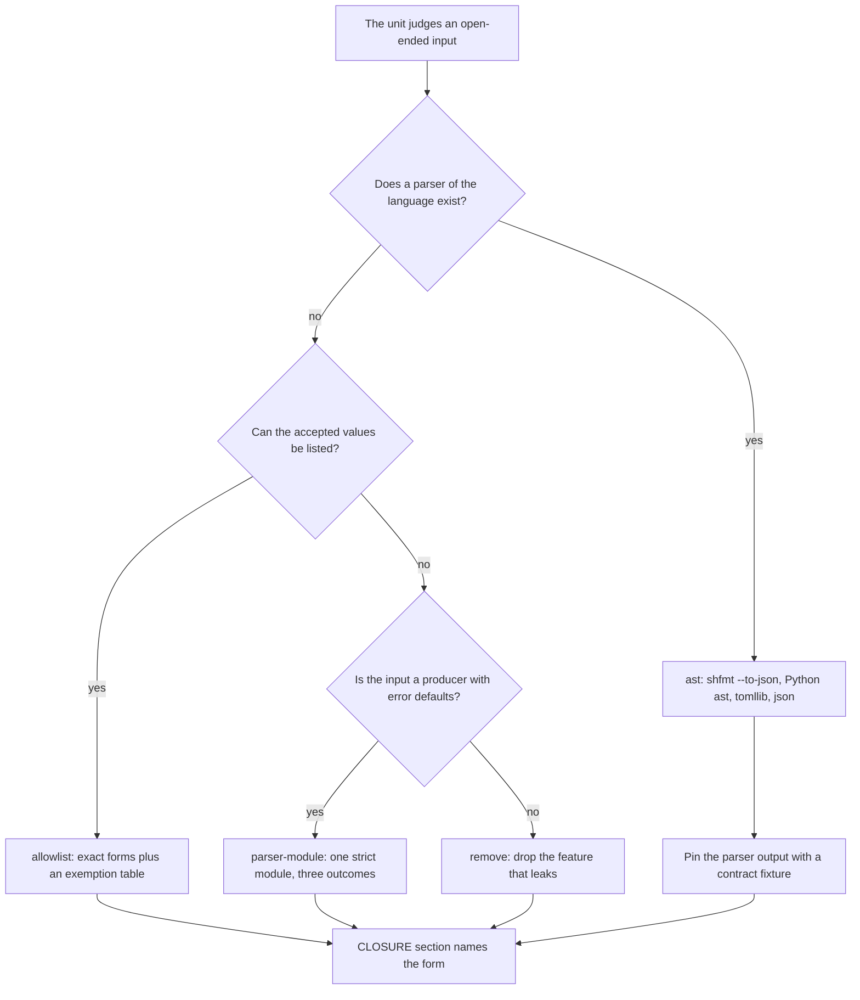
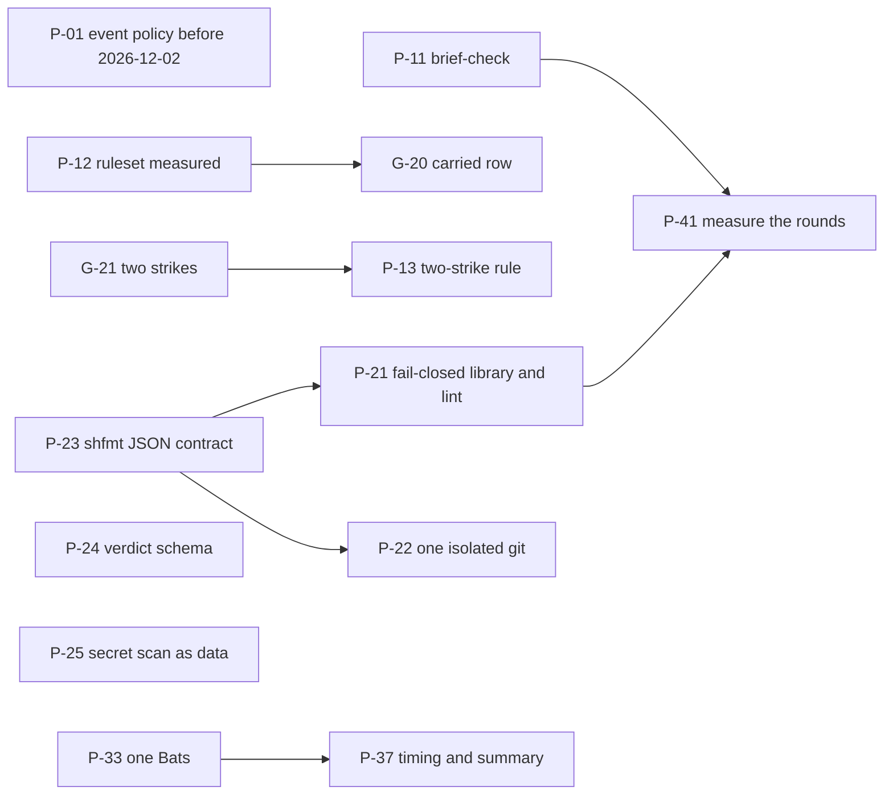

# Remediation plan for the implementation and verification phases, 2026-10-28

This file decides what the program changes next and why. It rests on three inputs. The measured phenomena and root causes are in [02-audit-treadmill-analysis.md](02-audit-treadmill-analysis.md) and the problem statement in [research/00-problem-statement.md](research/00-problem-statement.md). The vendor documentation and primary sources were read on 2026-10-28 and are listed in section 7. The two research files under [research/](research/) hold the full citations for the git, shell and CI findings. Every claim below carries one of three labels. "doc" is a vendor statement with its URL in section 7. "measured" is a probe or command run on this host or against the live repository on 2026-10-28. "inferred" is a conclusion of this plan.

The plan supersedes the proposal list in [03-remediation-spec.md](03-remediation-spec.md) where the two differ. R1, R2 and R3 of that file are kept and renumbered below. The specs there stay the brief-grammar text a coordinator copies.

## 1. What the research changed

Six findings moved a decision away from the handoff set's first draft.

1. Git documents no single switch that removes all configuration from a command. `GIT_CONFIG_GLOBAL=/dev/null` and `GIT_CONFIG_NOSYSTEM` are per-level switches and the repository level has none (doc). The records-sync design is complete for commands that run in the scratch repository and bounded, never isolated, for the one `ls-files` left in the checkout (measured, research/01 section 1.5). Four different isolation wrappers exist in the repository today, each hardened by its own audit rounds (measured). That is the treadmill class inside the fix. The plan makes one wrapper and a lint.
2. `git config --get` returns 1 for an unset key and 128 for an unparsable file on git 2.56.0 (measured). The manual lists 3 for an invalid file (doc). The round-10 reader in `records-sync.sh` treats every status other than 0 and 1 as a failure, so it is correct, but its comment names 3. Status 1 also covers an invalid key name and an unreadable `-f` file, the last with only a warning on stderr (measured). A reader pointed at an `-f` file must also test stderr.
3. `git ls-files` consulted a `core.fsmonitor` hook in every mode probed, including `--cached` alone, and the manual does not list it (measured, doc). An unreadable directory makes it warn, exit 0, keep the cached entries and drop the untracked ones (measured). The stderr-empty refusal added in U101 round 11 is the only mechanism that closes this.
4. ShellCheck's `check-extra-masked-returns` never flags a plain assignment from a command substitution, never looks at file redirections, and exempts `echo`, `dirname`, `basename`, `printf`, `set` and `shopt` (doc, research/01 section 2.3). `inherit_errexit` is not available on bash 3.2 (doc), and both `/bin/bash` and the `bash` on PATH on this macOS host are 3.2.57 while every lever but `pr-audit.sh` starts with `#!/usr/bin/env bash` (measured). A fail-closed rule that depends on `inherit_errexit` cannot run here. The plan encodes the rule as an AST grammar over command substitutions instead.
5. The Codex CLI documents `--output-schema`, `--output-last-message`, `--json`, `--ignore-user-config` and `--ignore-rules` for `codex exec` in CI, and codex-cli 0.164.0 on this host has all of them (doc, measured). `pr-audit.sh` reads the verdict from the last line of free text. The plan moves the verdict to a JSON schema. The same page says API keys are the right default for automation and the ChatGPT-login route is advanced (doc). Gate G18 chose the ChatGPT login on 2026-10-26. The plan keeps G18 and records the vendor's position.
6. GitHub enforces a default policy that blocks `pull_request_target` in public repositories on 2026-12-02 unless the repository has an explicit event policy (doc). The repository is public and its `regime` check runs on that event (measured, research/03 section 2.6). This is the one dated item and it goes first.

Two items the research did not settle. The audit-pipeline explorer stalled and was stopped, so no published data on fresh-context LLM review rounds was collected, and GitHub's Copilot code review was not evaluated as a reviewer. Both are listed as open in section 6.

## 2. Decisions

Each row names the root cause, the mechanism the sources support, what the program does today, and the decision. The unit ids point at section 4.

| Id  | Root cause                                       | Mechanism the sources support                                                                                                                                                                                                                                                                            | Today                                                                                                                                                                      | Decision                                                                                                                                                                                                                                                                                                                                                         | Units                    |
| --- | ------------------------------------------------ | -------------------------------------------------------------------------------------------------------------------------------------------------------------------------------------------------------------------------------------------------------------------------------------------------------- | -------------------------------------------------------------------------------------------------------------------------------------------------------------------------- | ---------------------------------------------------------------------------------------------------------------------------------------------------------------------------------------------------------------------------------------------------------------------------------------------------------------------------------------------------------------- | ------------------------ |
| D1  | RC1, hand-written judgement of open-ended inputs | A closed acceptance set, chosen before the first round. The four closing forms seen in the 13 treadmill rows are an AST walk, one strict parser module, an exact-form allowlist, and removal (measured). No vendor page states this as a rule. shfmt's manual says it parses all syntax statically (doc) | The treadmill rule fires after three rounds. Nothing checks a brief                                                                                                        | Adopt R1 as a script that refuses a TASK while a brief that names a trigger term has no `CLOSURE` section naming exactly one of the four forms                                                                                                                                                                                                                   | P-11                     |
| D2  | RC2, a failed read treated as an absence         | A reader that maps a producer to three outcomes and names the file. A lint over the grammar of command substitutions. A table of producers that exit 0 on partial failure (`git ls-files`, `git config -f`, `find`) that must have their stderr captured and tested (research/01 section 2.4)            | `check-extra-masked-returns` plus standing order 21 as text. One reader, `read_config`, in one lever                                                                       | Adopt the reader library and the AST lint. Do not depend on `inherit_errexit` (bash 3.2 on this host, measured). Enable `check-set-e-suppressed` only after a measured run over the lever set shows its finding count                                                                                                                                            | P-21                     |
| D3  | RC1 in the git isolation code                    | One function that sets the documented level switches and the `-c` overrides, scrubs `GIT_*` and the transport variables, and a lint that refuses any other `git` call in the levers (research/01 section 1.6)                                                                                            | Four wrappers with four flag sets (measured)                                                                                                                               | Adopt. The checkout listing stays bounded by `-c core.fsmonitor=false -c core.hooksPath=/dev/null` and the stderr refusal, which the research confirms as necessary and sufficient for those channels                                                                                                                                                            | P-22                     |
| D4  | RC2 inside the RC1 fix                           | A contract fixture that pins the shfmt JSON node types the walkers read, and a zero-visit refusal, because the typed JSON has no stability statement and changed in 3.6.0 and 3.14.0 (doc)                                                                                                               | Walkers read fields with `.get()` and would report nothing after a schema change (measured by reading the code)                                                            | Adopt                                                                                                                                                                                                                                                                                                                                                            | P-23                     |
| D5  | RC4, audit cost                                  | The vendor's machine-readable output (`--output-schema`, `-o`), `--ephemeral`, `--ignore-user-config`, `--ignore-rules` (doc)                                                                                                                                                                            | `pr-audit.sh` passes `--ephemeral -o` and parses `Verdict:` by hand. Config isolation comes from a scratch `CODEX_HOME`                                                    | Adopt the schema for the verdict and the two ignore flags. Keep the permission profile `audit`. Keep G18 (ChatGPT login) as the operator decided, and record that the vendor calls API keys the default for automation                                                                                                                                           | P-24                     |
| D6  | RC4, rounds bought by a merge of `main`          | GitHub's merge queue validates a merge-group commit that is not the PR head, requires `merge_group` triggers, and is built for busy branches (doc). `pr-merge.sh` pins the audited head with `--match-head-commit` (measured)                                                                            | Every head gets a fresh audit, including a merge of `main` (per-head verdict rule, U71)                                                                                    | Do not adopt a merge queue. Measure the ruleset's strict or loose status for required checks. Put one option to the operator, a `carried` ledger row when the three-dot diff digest is unchanged across a merge of `main` and CI is green on the new head. It changes a gate rule, so the operator decides                                                       | P-12, G-20               |
| D7  | RC3, reactive treadmill rule                     | A stopping condition on an evaluator loop, such as a maximum number of iterations (doc, Anthropic). The 13 rows show the mechanism change always came after three or more same-class rounds (measured)                                                                                                   | Three strikes                                                                                                                                                              | Adopt R2, two strikes. Operator gate because it changes a gate rule                                                                                                                                                                                                                                                                                              | P-13, G-21               |
| D8  | P5, secret-scan false positives                  | Provider patterns plus a small set of high-precision generic patterns, entropy on generic rules, allowlists by path and fingerprint, every finding reported (doc, GitHub secret scanning categories and the gitleaks rule model)                                                                         | One hand-written regex with a generic assignment rule, first hit stops the scan (measured)                                                                                 | Restructure the in-repo scan to the gitleaks rule model as data, report every finding, allow by fingerprint for fixtures. Do not add gitleaks as a dependency, because the scan runs from a tree that holds the validator alone and gitleaks is in security-patches-only mode (doc). Ask the operator to confirm GitHub push protection is on for the repository | P-25, G-22               |
| D9  | V4, CI reliability                               | The current vendor recommendations are listed per item in research/03                                                                                                                                                                                                                                    | Most are in place. Gaps are the apt call bounds, three workflows without `concurrency`, Bats version skew across CI images, and the event policy for `pull_request_target` | Adopt V4-2, V4-3, V4-5 and V4-6. Evaluate V4-4 and V4-9 with measured output. Schedule V4-1, V4-7, V4-8 and V4-10 after them                                                                                                                                                                                                                                     | P-01, P-02, P-31 to P-38 |
| D10 | V5, records PRs refused by the audit lever       | The lever's own contract requires a `## Contract` section (measured)                                                                                                                                                                                                                                     | The sync body has none, so records PRs get the orchestrator verdict                                                                                                        | Adopt R3                                                                                                                                                                                                                                                                                                                                                         | P-26                     |

### How a brief picks the closing form after D1

## 3. What the sources say about the designs that landed

This section records the verdict on the designs the program already shipped, so a later agent does not reopen a closed question.

| Design                                                                                                                      | Verdict                                                                                                                                                                                                                                 | Evidence                                               |
| --------------------------------------------------------------------------------------------------------------------------- | --------------------------------------------------------------------------------------------------------------------------------------------------------------------------------------------------------------------------------------- | ------------------------------------------------------ |
| records-sync.sh scratch repository, `GIT_*` scrub, identity on `commit-tree`, `--no-filters`, https push with the gh helper | Matches the documented switches. Complete for the scratch repository. Residuals are the default attributes and ignore files under the XDG config directory and the libcurl proxy and CA variables outside the `GIT_*` prefix (inferred) | research/01 sections 1.3 to 1.5                        |
| The `ls-files` stderr refusal and the directory walk (U101 round 11)                                                        | Necessary. No documented status covers the case                                                                                                                                                                                         | measured, research/01 section 1.1                      |
| `-c core.fsmonitor=false` on the listing (U101 round 12)                                                                    | Necessary and effective. The manual does not list `ls-files` among the commands that consult the hook                                                                                                                                   | measured                                               |
| `read_config` three-way status                                                                                              | Correct for literal keys read from the repository or global file. Not reusable for an `-f` file without a stderr test. The comment that names status 3 is wrong for 2.56.0                                                              | measured                                               |
| `pr-audit.sh` Python supervisor (`start_new_session`, `killpg`, subreaper on Linux)                                         | Matches the documented primitives. Process groups are not a containment boundary and macOS has no subreaper. The script documents that residual                                                                                         | doc, research/01 section 4                             |
| U99 bats wrapper that signals nothing                                                                                       | Correct for the vendor state. `BATS_TEST_TIMEOUT` hangs for the whole bound after a fast-failing test on 1.13.0 and 1.14.0 (issue #1206, open, confirmed 2026-09-25)                                                                    | doc                                                    |
| U100 scratch repositories with maintenance off                                                                              | Upstream deflaked its own suite the same way in 2.56                                                                                                                                                                                    | doc                                                    |
| U64b explicit `macos-15` labels                                                                                             | Matches. `macos-14` retires 2026-11-02. No `-latest` label is used                                                                                                                                                                      | doc, measured                                          |
| U102 unconditional drop of the Azure apt mirror                                                                             | Matches the staff workaround in #15142. The fault was mirror-side and declared healthy 2026-10-27. The drop has no exit condition                                                                                                       | doc                                                    |
| U96 chezmoi externals prefetch                                                                                              | Not vendor-documented. chezmoi documents no retry or timeout. The prefetch depends on an undocumented cache layout read from one version                                                                                                | doc                                                    |
| Pins for ccusage 20.0.37                                                                                                    | The 20.0.38 failure was a cooldown skew. The meta package cleared 72 h seconds before the install and its linux-x64 package 4 min 34 s after. npm skipped the optional package as documented. The pin's reason text is wrong            | measured against the registry, research/03 section 4.3 |

## 4. The units

Every unit is one brief, one branch and one PR, audited per head and merged by `pr-merge.sh`, as the hcom-orchestration skill requires. The id `P-nn` is a plan id. The adopting coordinator assigns the next `U<n>`. A `G-nn` row is a question for the operator in `gates.md` with the default named.

### Phase 0, dated items (before 2026-11-02 and 2026-12-02)

| Id   | Unit                                                                                                                                                                                                                                                                                             | Why first                                                                                                                                                                      | Acceptance                                                                                                     |
| ---- | ------------------------------------------------------------------------------------------------------------------------------------------------------------------------------------------------------------------------------------------------------------------------------------------------ | ------------------------------------------------------------------------------------------------------------------------------------------------------------------------------ | -------------------------------------------------------------------------------------------------------------- |
| P-01 | V4-5. An Actions event policy that allows `pull_request_target` for this repository, plus a test that pins the workflow's safety invariants (base-branch checkout only, `contents: read`, head fetched as data, body through `env:`)                                                             | GitHub enforces the default policy on 2026-12-02 (doc). Without it the `regime` check stops                                                                                    | The policy exists and is dated in `gates.md`. The test fails on a copy of the workflow with the `ref:` removed |
| P-02 | V4-1. A `decisions.tsv` row that names the next image retirements and the canary promotion condition                                                                                                                                                                                             | The macos-14 retirement lands 2026-11-02 and the `ubuntu-latest` migration completes 2026-11-19 (doc). The repository is on explicit labels, so this is a record, not a change | The row exists. The drift watch still exits 0 or 3                                                             |
| P-03 | Store maintenance R4. Correct the status-3 comment in `records-sync.sh` to "1 is unset, 128 measured for an unparsable file on 2.56.0, any status other than 0 or 1 is a failure". Extend standing order 19 with the https push form for an SSH origin. Decide the 17 three-field decisions rows | Documentation that disagrees with a measurement misleads the next reader                                                                                                       | The comment and the standing order match the measured table in research/01 section 1.2                         |

### Phase 1, the rules a brief runs under

| Id   | Unit                                                                                                                                                                                                                                                                                | Depends on | Acceptance                                                                                                                                     |
| ---- | ----------------------------------------------------------------------------------------------------------------------------------------------------------------------------------------------------------------------------------------------------------------------------------- | ---------- | ---------------------------------------------------------------------------------------------------------------------------------------------- |
| P-11 | R1. `scripts/orchestrator/brief-check.py` with the trigger-term table and the four closing forms, wired into hcom-orchestration step 1                                                                                                                                              | none       | The tests in [03-remediation-spec.md](03-remediation-spec.md) R1. The script run over every existing brief prints its exit code in the PR body |
| P-12 | Measure the ruleset. Read ruleset 24397953 and record whether required checks are strict (branch must be up to date) or loose. If strict, propose loose plus squash merge as a gate question, since strict forces an update-branch and therefore a fresh audit on every `main` move | none       | A `decisions.tsv` row with the API output                                                                                                      |
| P-13 | R2. Two-strike treadmill rule in the hcom-orchestration "Gates" section                                                                                                                                                                                                             | G-21       | The sentence and its test agree                                                                                                                |
| G-20 | Operator question. A `carried` ledger row for a merge-of-`main` head whose three-dot diff digest is unchanged and whose CI is green, written by a lever that computes both digests and refuses on any difference. Default if no answer, keep the per-head audit                     | P-12       | A `gates.md` row                                                                                                                               |
| G-21 | Operator question. Two strikes instead of three. Default if no answer, three                                                                                                                                                                                                        | none       | A `gates.md` row                                                                                                                               |

### Phase 2, the rules made checkable in code

| Id   | Unit                                                                                                                                                                                                                                                                                                                                                                                                                                        | Depends on | Acceptance                                                                                                                                                                                              |
| ---- | ------------------------------------------------------------------------------------------------------------------------------------------------------------------------------------------------------------------------------------------------------------------------------------------------------------------------------------------------------------------------------------------------------------------------------------------- | ---------- | ------------------------------------------------------------------------------------------------------------------------------------------------------------------------------------------------------- |
| P-21 | Fail-closed library and lint. `scripts/orchestrator/lib/read.sh` with `read_config`, `read_listing` (stderr captured and required empty) and `read_file`. `scripts/ci/producer-status-check.sh` as an shfmt JSON walk that refuses a command substitution outside the accepted grammar and requires the stderr capture for every producer in `scripts/ci/status-blind-producers.tsv`. A test that every reader has a failure-injection test | P-23       | Fixtures reproduce the five measured shapes. Zero findings over the lever set after adoption. ShellCheck 0.11.0 green                                                                                   |
| P-22 | One isolated git. `scripts/orchestrator/lib/git-isolated.sh` with `git_isolated` and `git_env_scrub`. The five levers and `lint-comparisons.py` read the one list. `scripts/ci/git-invocation-check.sh` refuses any other `git` call                                                                                                                                                                                                        | P-23       | The test in research/01 section 1.6 proves no hook, no URL rewrite and the environment identity under a hostile repository config. Generated copies equal their sources                                 |
| P-23 | shfmt JSON contract. `scripts/ci/shfmt_json_contract.py` parses one fixture holding every node kind the walkers read, asserts the `Type` strings and field names, exits 2 on mismatch. Each walker refuses a run that visited zero nodes of a kind the fixture produced                                                                                                                                                                     | none       | Renaming `Type` in a captured fixture fails the test                                                                                                                                                    |
| P-24 | Audit verdict as data. `pr-audit.sh` passes `--output-schema` with a schema of `verdict` (enum), `findings[]` (priority, confidence, path, line, rationale), `reproduced[]`, and the two ignore flags. The ledger row is written from the JSON. The `Verdict:` last-line parser is deleted                                                                                                                                                  | none       | A fixture codex that writes a schema-valid file produces the row. A non-conforming file fails closed. The live run on the next unit produces the same verdict text as before                            |
| P-25 | Secret scan as a rule table. `SECRET_PATTERN` becomes rows in a data file with id, regex, secret group, entropy threshold and keywords. The generic assignment rule gains an entropy threshold on the quoted value. An allowlist table by path regex and fingerprint covers the test fixtures. The scan reports every finding, never the first alone                                                                                        | none       | The two fixture names that failed `validate` in U101 rounds 10 and 13 pass under the allowlist and would be reported, not hidden, by the all-findings mode. A real-looking key in a fixture still fails |
| P-26 | R3. A `## Contract` section in the records-sync PR body                                                                                                                                                                                                                                                                                                                                                                                     | none       | `pr-audit.sh` audits the next records PR instead of refusing it                                                                                                                                         |
| G-22 | Operator question. Confirm GitHub secret scanning and push protection are enabled for the repository (public repositories have them available). Default if no answer, the in-repo scan stays the only layer                                                                                                                                                                                                                                 | none       | A `gates.md` row                                                                                                                                                                                        |

### Phase 3, CI

| Id   | Unit                                                                                                                                                                                                                          | Depends on | Acceptance                                                                     |
| ---- | ----------------------------------------------------------------------------------------------------------------------------------------------------------------------------------------------------------------------------- | ---------- | ------------------------------------------------------------------------------ |
| P-31 | V4-2. Every apt call bounded with `timeout --kill-after` and `Acquire::http::Timeout`, step bounds on the network steps, a closed-world rule in `test_apt_mirror.py`, and the re-check condition for the mirror drop recorded | none       | The new test fails before and passes after. `BoundOrderTest` still holds       |
| P-32 | V4-3. `concurrency` on `macos.yaml`, `ubuntu.yaml` and `private-bootstrap.yaml`, with a fixed queue group for the benchmark push                                                                                              | none       | One green run per workflow                                                     |
| P-33 | V4-6. Bats 1.14.0 from the one pin on every CI row and host, the apt and brew installs removed                                                                                                                                | none       | Every bats log prints `Bats 1.14.0`. The suite passes on all rows under 1.14.0 |
| P-34 | V4-8. Cooldown-skew check before installing a multi-package npm tool, and the pin reasons corrected                                                                                                                           | none       | A frozen-clock test reproduces the 2026-10-24 refusal                          |
| P-35 | V4-4. Evaluate the workflow lockfile with `gh actions-lock` output, and triage Dependabot #548 and #549                                                                                                                       | none       | A decisions row with adopt, defer or reject, and both PRs out of untriaged     |
| P-36 | V4-9. Evaluate `mise.lock` for the chezmoi-managed global config with a dry run                                                                                                                                               | none       | A decisions row with the measured output                                       |
| P-37 | V4-7. `--timing` and a `GITHUB_STEP_SUMMARY` line from the bats wrapper                                                                                                                                                       | P-33       | A recorded-stream test                                                         |
| P-38 | V4-10. Prove the chezmoi prefetch is consumed under a network-denied run                                                                                                                                                      | none       | A stub-chezmoi fixture fails, the real check passes on both bootstrap rows     |

### Phase 4, the plan verifies itself

| Id   | Unit                                                                                                                                                                                                                                               | Acceptance                                                                                                          |
| ---- | -------------------------------------------------------------------------------------------------------------------------------------------------------------------------------------------------------------------------------------------------- | ------------------------------------------------------------------------------------------------------------------- |
| P-41 | After five units have landed under P-11 and P-21, the coordinator writes a `decisions.tsv` row with the median audit rounds per unit before and after, from `ledger.tsv`, and the count of `treadmill` rows added. The row names the units counted | The row exists and cites the ledger rows. If the median did not fall, the row says so and names the next hypothesis |

### Dependencies

## 5. Verification of this plan

What was checked, and how.

- Measured on this host on 2026-10-28. git 2.56.0 exit codes for `git config --get` (unset 1, unparsable 128). `git ls-files` on a mode-000 directory (exit 0, warning, untracked entries dropped). The `core.fsmonitor` text of `git help config`. codex-cli 0.164.0 flags. The bash version at `/bin/bash` and on PATH (3.2.57). The lever shebangs. The ShellCheck optional check list for 0.11.0 and the repository `.shellcheckrc`. Four `pr-audit.sh` run times (478 s, 448 s, 359 s, 408 s).
- Read from vendor documentation on 2026-10-28. Every "doc" label in this file and the two research files. Section 7 lists the URLs.
- Inferred. The wall times per unit in 02, the residual list for the scratch repository, the statement that merge queue does not fit, and the expectation that P-11 and P-13 reduce rounds. P-41 measures that expectation.
- Not verified. Published data on fresh-context LLM review rounds. Copilot code review as a PR reviewer. Whether the ruleset's required checks are strict or loose (P-12 measures it). Whether GitHub push protection is on for the repository (G-22 asks).

## 6. Open questions for the operator

| Id              | Question                                                                                                                                         | Default applied if no answer                                   |
| --------------- | ------------------------------------------------------------------------------------------------------------------------------------------------ | -------------------------------------------------------------- |
| G-20            | Allow a `carried` ledger row across a merge of `main` when the three-dot diff digest is unchanged and CI is green on the new head                | No. Every head keeps its own audit                             |
| G-21            | Two strikes instead of three for the treadmill rule                                                                                              | No. Three strikes stay                                         |
| G-22            | Confirm secret scanning and push protection on the repository                                                                                    | The in-repo scan stays the only layer                          |
| G-18 (existing) | The vendor documentation calls API keys the right default for automation and the ChatGPT login advanced. Keep the 2026-10-26 decision or revisit | Keep G18. ChatGPT login through the `audit` permission profile |
| P-01            | Create the Actions event policy that allows `pull_request_target`                                                                                | None possible. The `regime` check stops on 2026-12-02          |

The operator answers in their own words in `gates.md`.

## 7. Sources

Vendor documentation and primary sources read on 2026-10-28.

- git. https://git-scm.com/docs/git-config, https://git-scm.com/docs/git, https://git-scm.com/docs/githooks, https://git-scm.com/docs/git-ls-files, https://git-scm.com/docs/gitattributes, https://git-scm.com/docs/git-hash-object, https://git-scm.com/docs/git-worktree, https://git-scm.com/docs/git-init, https://git-scm.com/docs/git-fsmonitor--daemon, https://github.com/git/git/blob/master/Documentation/RelNotes/2.55.0.adoc, https://github.com/git/git/blob/master/Documentation/RelNotes/2.56.0.adoc
- ShellCheck and shfmt. https://www.shellcheck.net/wiki/SC2312, https://www.shellcheck.net/wiki/SC2155, https://www.shellcheck.net/wiki/SC2181, https://www.shellcheck.net/wiki/SC2015, https://github.com/koalaman/shellcheck/wiki/Optional, https://raw.githubusercontent.com/mvdan/sh/master/cmd/shfmt/shfmt.1.scd, https://raw.githubusercontent.com/mvdan/sh/master/syntax/typedjson/json.go, https://raw.githubusercontent.com/mvdan/sh/master/CHANGELOG.md
- bash and process control. https://www.gnu.org/software/bash/manual/html_node/The-Set-Builtin.html, https://www.gnu.org/software/bash/manual/html_node/The-Shopt-Builtin.html, https://docs.python.org/3/library/subprocess.html, https://man7.org/linux/man-pages/man3/killpg.3.html, https://www.gnu.org/software/coreutils/manual/html_node/timeout-invocation.html, https://raw.githubusercontent.com/actions/runner/main/src/Runner.Sdk/ProcessInvoker.cs
- Codex CLI. https://developers.openai.com/codex/noninteractive (served as https://learn.chatgpt.com/docs/non-interactive-mode), https://learn.chatgpt.com/docs/permissions, https://learn.chatgpt.com/docs/agent-approvals-security, https://developers.openai.com/codex/cli/reference
- Anthropic. https://code.claude.com/docs/en/sandboxing, https://www.anthropic.com/research/building-effective-agents
- GitHub. https://docs.github.com/en/repositories/configuring-branches-and-merges-in-your-repository/configuring-pull-request-merges/managing-a-merge-queue, https://docs.github.com/en/repositories/configuring-branches-and-merges-in-your-repository/managing-rulesets/available-rules-for-rulesets, https://docs.github.com/en/actions/reference/security/securely-using-pull_request_target, https://github.blog/changelog/2026-09-17-workflow-execution-protections-in-github-actions-generally-available/, https://docs.github.com/en/actions/concepts/security/workflow-dependency-lockfiles, https://github.blog/changelog/2026-10-14-github-actions-workflow-lockfiles-in-public-preview, https://docs.github.com/en/code-security/reference/secret-security/supported-secret-scanning-patterns, https://docs.github.com/en/actions/reference/workflows-and-actions/workflow-syntax
- Runner images. https://github.com/actions/runner-images/issues/13518, https://github.com/actions/runner-images/issues/14823, https://github.com/actions/runner-images/issues/15040, https://github.com/actions/runner-images/issues/15142, https://github.com/actions/runner-images/issues/14748, https://github.com/actions/runner-images#available-images
- Bats, npm, mise, chezmoi, gitleaks. https://bats-core.readthedocs.io/en/stable/writing-tests.html, https://github.com/bats-core/bats-core/issues/1206, https://github.com/bats-core/bats-core/issues/1020, https://docs.npmjs.com/cli/v11/using-npm/config, https://docs.npmjs.com/cli/v11/configuring-npm/package-json, https://mise.jdx.dev/dev-tools/mise-lock.html, https://www.chezmoi.io/reference/special-files/chezmoiexternal-format/, https://github.com/gitleaks/gitleaks/blob/master/README.md
