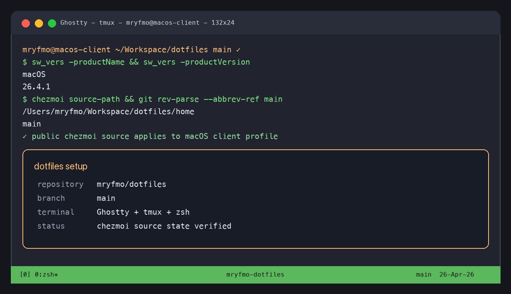
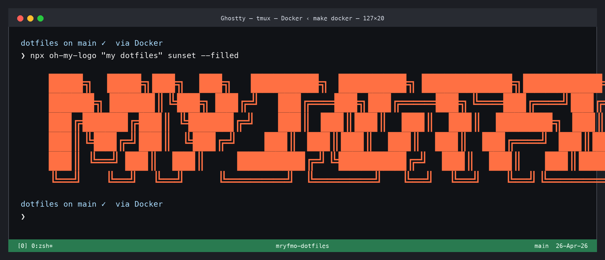

<div align="center">
    
    <h1>📂 dotfiles</h1>
</div>

<div align="center">

[](https://github.com/mryfmo/dotfiles/actions/workflows/remote.yaml)
[](https://github.com/mryfmo/dotfiles/actions/workflows/test.yaml)
[](https://codecov.io/gh/mryfmo/dotfiles)

[](https://github.com/zsh-users/zsh)
[](https://github.com/rossmacarthur/sheldon)
[](https://github.com/starship/starship)
[](https://github.com/jdx/mise)

[](https://github.com/anthropics/claude-code)
[](https://github.com/openai/codex)

</div>

## 🗿 Overview

This [dotfiles](https://github.com/mryfmo/dotfiles) repository is managed with [`chezmoi🏠`](https://www.chezmoi.io/), a great dotfiles manager.
The setup scripts are aimed for [MacOS](https://www.apple.com/jp/macos), [Ubuntu Desktop](https://ubuntu.com/desktop), and [Ubuntu Server](https://ubuntu.com/server). The first two (MacOS/Ubuntu Desktop) include settings for `client` machines and the latter one (Ubuntu Server) for `server` machines.

The actual dotfiles exist under the [`home`](https://github.com/mryfmo/dotfiles/tree/main/home) directory specified in the [`.chezmoiroot`](https://github.com/mryfmo/dotfiles/blob/main/.chezmoiroot).
See [.chezmoiroot - chezmoi](https://www.chezmoi.io/reference/special-files-and-directories/chezmoiroot/) more detail on the setting.

## 📥 Setup

To set up the dotfiles run the appropriate snippet in the terminal.

### 💻 `MacOS`

- Configuration snippet of the Apple Silicon MacOS environment for client macnine:

```console
bash -c "$(curl -fsLS https://raw.githubusercontent.com/mryfmo/dotfiles/main/setup.sh)"
```



On a GitHub Actions runner, the Homebrew installer (`install/macos/common/brew.sh`) also handles the third-party taps that the runner image ships untrusted, so that `brew install` does not warn about them; anywhere else, an agent shell that exports `CI=true` included, it leaves your taps alone.

### 🖥️ `Ubuntu`

- Configuration snippet of the Ubuntu environment for both client and server machine:

```console
bash -c "$(wget -qO - https://raw.githubusercontent.com/mryfmo/dotfiles/main/setup.sh)"
```



On a fresh machine, enter the age passphrase only when the interactive prompt appears; GitHub authentication is intentionally deferred, so run `setup-gh` after the public apply. The next `make update` installs the configured GitHub CLI extensions. On Ubuntu Desktop, add **Japanese (Mozc)** under **Settings → Keyboard → Input Sources** after installation. Ubuntu clients use zsh from the next login; run `exec zsh` to switch the current terminal immediately.

The [Snippet install](https://github.com/mryfmo/dotfiles/actions/workflows/remote.yaml) workflow bootstraps the public source on both systems on every relevant pull request. The `MacOS`, `Ubuntu` and `Private bootstrap` workflows also restore the private dotfiles, so they need the `EMAIL_ADDRESS` and `PRIVATE_DOTFILES_PRIVATE_DEPLOY_KEY` repository secrets. Without them only their `secrets` job runs: its summary says the bootstrap did not run, and the bootstrap jobs show as skipped, so a green run of those workflows verifies nothing.

### Minimal setup

The following is a minimal setup command to install chezmoi and my dotfiles from the github repository on a new empty machine:

> sh -c "$(curl -fsLS get.chezmoi.io)" -- init mryfmo --apply

## ⚙️ Install & Setup Application Individually

This repository provides for the installation and setup of each application individually.
The desired application can be installed as follows (e.g., docker installation on MacOS):

```shell
bash install/macos/common/docker.sh
```

Each installation script can be found under the [`./install`](https://github.com/mryfmo/dotfiles/tree/main/install) directory.

### Remote shells with mosh

`mosh` is installed on both Ubuntu (apt) and macOS (Homebrew) by the common
dependency scripts. Over Tailscale, mosh's UDP ports 60000-61000 stay inside
the tailnet, so this repository adds no firewall rule. `mosh user@host` starts
`mosh-server` through a non-interactive SSH command, and `~/.zshenv` puts the
Homebrew and local bin directories on `PATH` for exactly that case. The UTF-8
locale that `mosh-server` needs comes from `install/ubuntu/common/setup_locale.sh`.
A host that runs its own firewall (for example ufw) must allow that UDP range on
its Tailscale interface.

### Log in on a remote host

An omp seat on the Ubuntu host, reached from the laptop through
`herdr --remote <ssh-target>`, needs that host's own Claude and ChatGPT logins.
A login is per host: each host signs in once, keeps its own tokens and refreshes
them itself. Nothing copies a token between hosts. The browser for the consent
click is the laptop's. The design and the threat table are in
[docs/remote-host-logins.md](docs/remote-host-logins.md); the steps:

1. On the laptop, add `Tag seat-host` to the Ubuntu host's entry in
   `~/.ssh/conf.d/`. The managed `~/.ssh/config` then forwards
   `127.0.0.1:1455` to that host (the ChatGPT sign-in callback) and
   `127.0.0.1:1456` back to the laptop (the URL opener). This applies to every
   SSH session to it, `herdr --remote` included.
2. On the laptop, load the URL opener once:
   `launchctl bootstrap gui/$(id -u) ~/Library/LaunchAgents/com.mryfmo.dotfiles.url-opener.plist`.
   It opens only https sign-in URLs on `auth.openai.com`, `claude.com`,
   `claude.ai`, `console.anthropic.com` and `platform.claude.com`, and logs its
   start and each decision to `~/.local/state/hcom/url-opener.log`.
3. On the Ubuntu host, in your own terminal, run
   `seat-login-preflight <profile>` for each seat profile (orchestrator,
   worker, audit) that `make doctor` reports absent. The ChatGPT sign-in completes through the forwarded callback. The
   Claude sign-in shows a code in the laptop tab; paste it at the terminal
   prompt. If that flow fails, run `claude setup-token` on the laptop and store
   the token in `~/.config/claude-code/oauth-token` (mode 0600) on the Ubuntu
   host; `~/.zshenv` (every zsh) and `~/.profile` export it as
   `CLAUDE_CODE_OAUTH_TOKEN`, and the managed Claude settings withhold both the
   variable and the file from sandboxed commands.
4. `make doctor` on the Ubuntu host lists each seat profile under "Seat logins"
   from presence and mtimes only.
5. `hcom-seat <role>` there runs the same pre-flight before it starts a seat.
   It also checks that the seat can use the login: a ChatGPT login stored in
   the profile's `agent.db`, and `CLAUDE_CODE_OAUTH_TOKEN` in the shell when
   the token file is the only Claude login (open a new login shell after
   writing it). A seat never runs a login: without one, it refuses and names
   the command.

### Private credentials and keys

This public repository intentionally does not store machine-specific secrets such as SSH private keys, GnuPG secret keyrings, or VPN credentials. Private state belongs in the separate `mryfmo/dotfiles-private` chezmoi source or should be generated on the target machine.

After applying the public dotfiles, use the following explicit setup helpers when private state was not restored:

```shell
setup-gh                 # log in through scripts/gh-auth.sh, create or reuse ~/.ssh/id_ed25519(.pub), then register it with GitHub under a one-off login
setup-gpg                # create a GnuPG secret key interactively when no local secret key exists
provision-machine-key    # generate ~/.ssh/id_ed25519(.pub) non-interactively, then print the gh ssh-key add commands
```

VPN credentials such as AnyConnect profiles are not generated by the public installer. Add them to the private chezmoi source only when they are still needed on the target machine.

The managed git config signs commits (`commit.gpgsign = true`, `gpg.format = ssh`, `user.signingkey`) only when `~/.ssh/id_ed25519.pub` exists at apply time; on a fresh machine commits are unsigned until then. Run `provision-machine-key` to generate the key and print the exact `gh ssh-key add ... --type authentication|signing` commands for the operator's account, then `chezmoi apply`. `make doctor` (`scripts/check-tools.sh`) prints an optional notice while signing is off, and a required failure if `commit.gpgsign` is true but the file named by `user.signingkey` is missing (only possible through a hand edit). `setup-gh` uploads the key under a separate one-off login in a temporary `GH_CONFIG_DIR`, so the machine login that every agent uses never gains `admin:public_key` or `admin:ssh_signing_key`.

Host cleanup that the installers do not do (old tool versions, stray binaries, retired worktrees, credential rows) is listed with its read-only checks in the [G16 operator handout](docs/operator-handout-g16.md).

## 📚 Documentation

This repository can generate a temporary MkDocs site from the shell-based setup assets.
The generated Markdown lives under `docs/reference/`, `docs/index.md` is regenerated as a landing page, `docs/catalog.md` is regenerated as the full catalog, and internal Codex working notes live under `.agents/worklog/` so they are not published.

```shell
make docs
make serve
make serve PORT=8001
make deploy
```

- `make docs`: generate Markdown with `shdoc` (falling back to source-based pages when needed) and rebuild the site.
- `make serve`: preview the generated site locally with MkDocs on `127.0.0.1:8000` by default.
- `make serve PORT=8001`: preview the site on a different local port when `8000` is already in use.
- `make deploy`: publish the current generated site to the `gh-pages` branch.

## 🛠️ Update & Test 🧪

Updating and testing the dotfiles follows [chezmoi's daily operations](https://www.chezmoi.io/user-guide/daily-operations/).
To verify that the updated scripts work correctly, run the scripts on the actual local machine and on the docker container.

### Lifecycle

The public lifecycle has three entry points: `setup`, `update`, and `doctor`.
`setup.sh` prepares a machine for dotfiles management and runs `chezmoi apply`, but it must not upgrade already-installed tools just because the bootstrap command was re-run; upgrading installed tools is part of `make update`.
Use the explicit lifecycle commands below instead:

```shell
# First-time remote bootstrap from any directory. On a clean machine this
# clones the repository into chezmoi's sourceDir, usually ~/.local/share/chezmoi.
# If ~/.config/chezmoi/chezmoi.yaml already defines sourceDir, setup.sh reuses
# that configured source directory instead of creating ~/.local/share/chezmoi.
bash -c "$(curl -fsLS https://raw.githubusercontent.com/mryfmo/dotfiles/main/setup.sh)"

# Makefile lifecycle commands must run from the repository root, not from $HOME.
# Because .chezmoiroot is "home", chezmoi source-path points at the managed
# source subtree, for example ~/.local/share/chezmoi/home. Use git to move back
# to the repository root that contains Makefile, regardless of the configured
# sourceDir.
cd "$(git -C "$(chezmoi source-path)" rev-parse --show-toplevel)"

# Pull and apply the repository, update installed tools to the latest safe
# versions, and refresh agent assets.
make update
# Include operating-system package upgrades such as apt when you want them:
make update SYSTEM=1

# Inspect the current tool state without modifying it.
make doctor
```

`SYSTEM=1`, `SYSTEM=true`, and `SYSTEM=yes` enable operating-system package
upgrades. Other values, including `SYSTEM=0`, keep `make update` in user-level
tooling mode.

**Tool versions.** Only a held tool commits a version. `home/dot_mise/config.toml`
requests `"latest"` for every tool that is not held back (below), and there is no
`mise.lock`, so `make update` moves each of those tools to the newest release
its manager allows and changes no file in the repository. The safety comes from
each manager's own features. mise skips releases younger than
`minimum_release_age = "72h"` ("Skip versions published more recently than this
duration or date", [mise settings](https://mise.jdx.dev/configuration/settings)):
72 hours goes past the 24-hour default of mise and pnpm and past pnpm's "In most
cases, malicious releases are discovered and removed from the registry within
an hour", but stops short of the several days over which the Shai-Hulud worm
re-infected packages in waves, because a longer delay also holds back security
fixes. mise also keeps its default-on verification settings `aqua.cosign`,
`aqua.minisign`, `aqua.slsa`, `aqua.github_attestations`, `github_attestations`
and `node.verify`, which need no lockfile, and `mise upgrade` without `--bump`
"keeps the range specified in mise.toml"
([mise upgrade](https://mise.jdx.dev/cli/upgrade)), so a held exact version
stays exact. Per the settings page the cooldown covers every backend this
config uses except `http:` (whose tools that file pins exactly, with a checksum); a live
probe on 2026-10-09 showed the setting acting on core `node` (26.11.1 without
it, 26.10.0 with it). `mise self-update` waits the same 72 hours through
`self_update.minimum_release_age = "72h"` (unset, it would inherit the global `minimum_release_age`, else 24h; it is set explicitly all the same), and Codex
and Claude Code follow the same cooldown. The managed `~/.npmrc` sets npm's own
`min-release-age=3`, the same 72 hours, so every npm install on the host agrees
with the release mise chose. A `node` major bump can leave `npm:` tool installs
invalid until `mise install` reruns, so `make update` records the `node` they
were built on in `${XDG_STATE_HOME:-~/.local/state}/dotfiles/npm-tools-node`;
when `node` differs from it (or it is missing), whatever moved `node`, it
rebuilds each `npm:` tool at its current version, keeping the previous install
until the new one succeeds (an offline or interrupted rebuild leaves the working
tool in place), and then runs `mise install` once more. The marker is written only after
both succeed, and a marker that cannot be written fails the update.
`mise self-update --no-plugins` leaves installed mise plugins such as `shdoc`
alone, because a plugin update is a branch move the cooldown does not cover;
run `mise plugins update` when you want one.
Homebrew bottles are verified against
their build attestations (`HOMEBREW_VERIFY_ATTESTATIONS=1`) when `gh` is
present. Homebrew, `uv tool upgrade --all` and GitHub CLI extensions take their
newest release, and apt (`SYSTEM=1`) the distribution's. The trade-off: with no
exact pins and no committed lock, machines may differ in tool versions, and CI
tests the latest safe versions rather than one recorded set. Because the
applied file is mise's global config, it no longer turns on lockfile mode for
other projects on the host; a project that keeps its own `mise.lock` sets
`lockfile` in its own config. The release-asset installers follow the same
policy where they can: an asset takes the newest release when its publisher
verifies it independently of the release page, and the others keep a reviewed
pin (see Asset manifest below).

**Claude Code version.** The mise entry `"npm:@anthropic-ai/claude-code"` in
`home/dot_mise/config.toml` is the only version channel for Claude Code, and
`make update` moves it like every other tool. Claude Code's own updater is
blocked in the login environment: `home/dot_zshenv` (every zsh, which the
server's `bashrc` execs into) and `home/dot_profile` (the server's bash login
shell) export `DISABLE_UPDATES=1`, which "block[s] all updates including manual
`claude update` and `claude install`", and `DISABLE_AUTOUPDATER=1`, which stops
the background check ([env vars](https://code.claude.com/docs/en/env-vars)).
The managed template names no release channel, and on `chezmoi apply` the
settings merge (`home/dot_claude/modify_private_settings.json`) drops
`autoUpdates: false` and `autoUpdatesChannel: "stable"` from an installed
`~/.claude/settings.json`, the values the template used to set. A different
value there is an operator override and stays. `claude update` is therefore not
a supported command here; it prints `Updates are disabled by your
administrator`. To hold Claude Code at one release, pin an exact version in the
mise entry instead of `latest` (see Holding a tool back below).

**Holding a tool back** uses the manager's own feature:

- mise: an exact version in `home/dot_mise/config.toml` with a `# Held:` comment
  that says why; those comments are the current list of held tools, and the
  `http:` tables pin their version with a checksum;
- Homebrew: `brew pin <formula>`;
- uv: `uv tool install <package>==<version>`;
- apt: `sudo apt-mark hold <package>`.

The **operator phase** is the interactive part, run once per machine:
`./setup.sh` (chezmoi init prompts, the age passphrase, the sudo keepalive, the
macOS Command Line Tools prompt, Ubuntu `chsh`, the SSH, `gh` and Codex logins,
and the `run_once_*` scripts), plus `sudo -v` right before `make update` when
the pulled diff touches `install/**` or `.chezmoiscripts/**`, and with
`SYSTEM=1`. Everything after
it is unattended: `make update` never prompts, except that a Homebrew cask
whose upgrade runs an installer package can ask for the sudo password.

`make update` applies all committed public and private chezmoi state, including
scripts. Chezmoi records each `run_once` content hash, so new or changed
one-time installers run once while unchanged installers stay skipped. Before
applying, `make update` runs
`git pull --ff-only` only when the checkout is on `main`, tracks `origin/main`,
and has no staged or unstaged tracked-file changes. Otherwise it prints the
reason and the exact manual `git -C <repo> pull` command, then continues with
the local source; a failed fast-forward pull also warns and continues. The
pull runs first, in its own step, and a second `make` (`update-tree`) runs the
rest from the Makefile it fetched, so a recipe change lands in the same run. On
a host whose clone predates this split, the first `make update` would still run
the old recipe; run `git -C <clone> pull && make -C <clone> update` once instead.
`chezmoi apply` refuses a source tree whose `home/`, `install/` or `scripts/`
differ from the last-fetched `origin/main`, through uncommitted, unmerged,
unpushed or not yet pulled changes (override `CHEZMOI_ALLOW_DIRTY_SOURCE=1`), so
changes reach the host only through a merged pull request; git-ignored untracked
files are not checked. `make update` then runs `scripts/upgrade-tools.sh`, which
installs missing mise tools and upgrades outdated ones from the applied
`~/.config/mise/config.toml`, then Homebrew packages, uv tools and GitHub CLI
extensions (apt with `SYSTEM=1`); it exits 0 without changes on a GitHub Actions
runner.
The network-only phases (Homebrew, `mise self-update`, uv tools, GitHub CLI
extensions) only warn when they fail, so an offline host with its tools
installed still converges; `make update` stops before the asset refresh only
when a declared mise tool cannot be installed, or apt fails with `SYSTEM=1`.
`make apply` is the same target.
Every CI-only path (the guard skip above, `brew info` instead of `brew install`
in the macOS installers, the runner's tap trust, the `upgrade-tools.sh` skip,
the chezmoi config without age encryption) is taken only on a GitHub Actions
runner: `GITHUB_ACTIONS=true` with `RUNNER_TEMP` set, as decided by
`scripts/lib/ci-runner.sh`, never by `CI`. An agent shell does not count: omp's
bash tool exports `CI=true`, `npm_config_yes=true`, `GIT_EDITOR=true` (and
`EDITOR`/`VISUAL=true`) and `GIT_TERMINAL_PROMPT=0` into every command, so
`make update` or `chezmoi apply` run from it behaves as on the host. The other
variables change nothing these targets do: none runs `npx` or `npm exec`, the
pull is `--ff-only`, and a fetch that would need credentials fails instead of
prompting, which `make update` reports and continues with the local source.
`chezmoi apply` retries what an apply without a terminal could not finish: the
age identity restore asks for its passphrase on the next interactive apply, and
on Ubuntu the bwrap AppArmor profile installs on the next apply with cached
`sudo`.
The asset refresh also converges configured GitHub CLI extensions, and syncs the
vendored CompactionDB tree. It then reloads a
running Herdr server, skips reload
when the server is reported as not running or the command is unavailable, and
fails on reload errors other than `protocol_mismatch`. When the server status
cannot be read or is unknown, it prints
`Herdr server unreachable; skipping config reload.` and continues. A
protocol mismatch after updating Herdr prints instructions to stop and restart
the server (or recreate the Ghostty session), then continues successfully; run
`herdr server reload-config` manually after restarting.

Weekly model-usage measurement is informational and never changes
`model_profiles`. Capture or report usage manually with:

```shell
make usage-snapshot
make usage-report
```

On macOS, chezmoi manages a LaunchAgent that runs both targets every Monday at
09:00 and writes stdout/stderr to
`~/.config/dotfiles/usage-review.log`. After `make update`, load it once:

```shell
launchctl bootstrap gui/$(id -u) \
  ~/Library/LaunchAgents/com.mryfmo.dotfiles.usage-snapshot.plist
```

Usage reports only surface +7d/+14d review reminders and model-share evidence.
Any model-profile decision still requires manual quality review and a PR.

### Agent review and permission assets

`make update` also refreshes agent-managed assets, configured GitHub CLI
extensions, and the vendored CompactionDB tree after `chezmoi apply`.
The generated `create_marketplace.json` seeds `~/.agents/plugins/marketplace.json`
only when it is missing; plugin runtimes own later content and mode changes.
This includes the Crit integrations, the Ponytail (`ponytail@ponytail`) plugin,
and the Understand-Anything (`understand-anything@understand-anything`)
knowledge-graph plugin for Codex and Claude Code. Understand-Anything installs
from the `Egonex-AI/Understand-Anything` marketplace for Claude Code and via
the upstream installer for Codex, pinned to a reviewed commit and verified by
sha256 before execution (bump both constants together in
`scripts/update-agent-assets.sh` to take upstream installer updates). The
installer clones `~/.understand-anything/repo` and symlinks its skills into
`~/.agents/skills` (`make doctor` knows them as installer-owned and reports
neither an unmanaged skill nor an orphan); Codex runtime files are provisioned from the version-matched Claude release artifact when available.
`make update` also builds the plugin's `packages/core` with the mise-pinned
`npm:pnpm` (run through `mise exec`, which installs the pin on demand) when
its `dist/index.js` is missing or older than any file under
`packages/core/src` or the root `pnpm-lock.yaml` (in the release artifact, or
in the Codex clone without one), so the plugin's graph helpers run, and
`make doctor` warns under the same rule, so `make update` repairs what it reports.
This repository refreshes `.ua/` only by a full rebuild (`/understand --full`),
run by a worker task when the operator asks for it at a regime boundary.
Incremental updates cannot publish here: plugin 2.9.7's symbol gate
(`validate-incremental-symbols.mjs`) marks every unowned function `unknown` in
files without a deterministic parser, namely the extension-less shell script
`executable_hcom-dispatch` and the Python chezmoi script
`modify_private_settings.json`. The plugin has no per-path language override.
`.ua/config.json` therefore sets `autoUpdate: false`, which stops the plugin's
SessionStart and PostToolUse update prompts. Between rebuilds the graph is
stale by design, and agents fall back to grep under the freshness check.
A `.ua/` refresh is accepted only when `ua-symbol-coverage` (installed on PATH
from `home/dot_local/bin/common/executable_ua-symbol-coverage`), run with
`--repo-ref` and `--old-ref` set to the revisions the new and previous graphs
were built from (so renames are told apart from deletions), shows no
unexplained per-file function/class regressions against the previous graph
(`home/dot_config/claude/rules/understand-anything.md`).
Plugin 2.9.7 has two known coverage gaps: `merge-batch-graphs.py` drops
`tested_by` edges from `.bats` tests and from non-`file:` production nodes, and
`extract-structure.mjs` misses shell functions with a subshell body. A full
rebuild therefore under-reports test coverage until upstream fixes land.

Crit itself is installed on both Linux and macOS from the pinned amd64/arm64
GitHub release binary for the matching OS, after SHA-256 verification against
the reviewed checksum and, as a second check, the release's `checksums.txt`.
All four checksums and the version are declared under `assets.crit` in
`home/dot_agents/agent-config.yaml`, rendered into
`scripts/lib/installer-pins.sh`, and changed with `generate-agent-configs.py --set-asset`. Lifecycle
checks on both platforms inspect the authoritative `~/.local/bin/crit`
directly, prepend `~/.local/bin` to `PATH`, and run `hash -r` so an older
ambient Crit cannot shadow it. If that managed binary is missing, `REPAIR=1
make doctor` can restore it.

The zenbu-labs terminal tools — terminal-code (`tode`) and `terminal-browser` —
install through their upstream curl installers, pinned by version and
installer checksum under `assets:` (rendered into
`scripts/lib/installer-pins.sh`). zenbu-labs publishes no checksum file or
attestation and signs no script, so the committed script hash is the only
integrity check; each script embeds the sha256 of its platform payload and
verifies the download against it, so that hash pins the payload too.
`make update` converges both tools to the pinned versions; a pin changes only
in `assets:` (see Asset manifest below).
terminal-browser links its bundled agent skills into `~/.agents/skills`
(installer-owned in `make doctor`, tracked by its
`~/.local/state/terminal-browser/skills.links` receipt), and its editor setup
is always skipped in lifecycle runs — run `terminal-browser setup` once
manually if wanted.

Model selection is governed by `model_profiles` in
`home/dot_agents/agent-config.yaml`, the single place where model IDs and
efforts live. The generator renders the interactive profile into the managed
Claude settings and Codex config, one `~/.codex/<profile>.config.toml` file per
profile for `codex --profile <name>`, `~/.agents/model-profiles.env` for the
launchers, and the low-cost `express-explorer` Claude subagent.
`make render-check` runs `uv run --with pyyaml scripts/generate-agent-configs.py
--check` to confirm every rendered file matches the manifest; tasks and docs
name that one command, since a bare `python3` run fails without PyYAML.

Agent work runs as a three-role constellation, each role on a `model_profiles`
entry (the model IDs and efforts live there, not in this page). The
orchestrator uses the `deep` profile to author tasks, review results, and own
acceptance. The worker uses the `standard` profile to implement one task at a
time. Reviews of plans and task texts run on the `review` profile, the same
Claude model and effort as `deep` in a fresh context (INV-7). The auditor runs
one independent task-level audit of each final head as one fresh
`~/.local/bin/common/omp-run.sh --role audit` per head (`hcom-orchestration`
SKILL, step 4): omp on the omp model of the `audit` profile, through the
`openai-siwc` extension, under omp's approval policy
`home/dot_agents/omp/policies/audit.yml` (`always-ask`, the write tools
denied). That policy gates tools; it is not an operating-system read-only
sandbox, and the run's account stays the containment boundary. When that route
cannot run, the `## Audit` section of `AGENTS.md` names the fallback review;
its Codex route is `~/.local/bin/common/pr-audit.sh <pr>`, whose commands run
under the Codex permission profile `audit` (an allowlist: the head's tree and
the tools only, no network, credential stores denied, probed before every run;
`scripts/orchestrator/README.md`).
The responsibility boundaries live in
`home/dot_config/claude/rules/model-selection.md`,
`home/dot_config/claude/rules/regime.md`, and the `## Audit` section of
`AGENTS.md`. The Codex models of the `standard` and `audit` profiles need no
API-key authentication: both answered under the ChatGPT login (probe
2026-10-05). Both xhigh settings answered on 2026-10-09: the Codex audit probe
under the ChatGPT login, the Claude worker probe under the Anthropic login.

On Ubuntu 24.04 and later, `kernel.apparmor_restrict_unprivileged_userns=1`
stops `/usr/bin/bwrap` from creating the user namespaces that sandboxed Codex
runs need. Rather than relaxing that sysctl globally, `chezmoi apply` installs
the `bwrap-userns` AppArmor profile
(`install/ubuntu/common/apparmor/bwrap-userns`, loaded by
`install/ubuntu/common/apparmor_userns.sh` with `sudo -n`), and `make doctor`
probes `bwrap` to confirm it works. Without cached sudo credentials the
installer never prompts: it leaves the profile pending, and `make doctor`
reports it missing. Install it with
`sudo -v && bash install/ubuntu/common/apparmor_userns.sh` from the repository
root, or run `sudo -v` before the next `make update`: every `chezmoi apply`
loads it again until the installed copy equals the repository's and `bwrap`
can create a user namespace (the `make doctor` probe). To remove it, run
`sudo apparmor_parser -R /etc/apparmor.d/bwrap-userns` and then
`sudo rm /etc/apparmor.d/bwrap-userns`; a later apply with cached `sudo` installs
it again while the host still needs it.

`permgate` handles Claude Code and Codex PermissionRequest hooks from the
repo-owned policy at `~/.agents/permgate-policy.yaml` and is deterministic
only: deny patterns run first, then allow patterns for single, bounded
commands. Every other request, including unconstrained reads and searches,
writes such as `apply_patch`, and any policy or input failure, falls through
to the agent's native prompt. For Claude Code, permgate never approves a
command that the sandbox excludes (`sandbox.excludedCommands` in the rendered
`~/.claude/settings.json`, today `git push *` and `gh *`), because such a
command runs unsandboxed and its ask rule is its only gate. It counts a match
anywhere in the command, behind `env`, `command`, a variable assignment, a
full path or `git -C`, and decides nothing at all for Claude when it cannot
read that set. permgate runs no classifier model. The audit
JSONL records each decision with an input hash and a command summary, never
payload values. ccgate is fully removed.

The intended lifecycle is:

```shell
# Apply ~/.codex, ~/.claude, ~/.config/mise, and agent rule files.
make update

# Ponytail is installed from the upstream marketplace.
# Claude Code and Codex use DietrichGebert/ponytail as the marketplace source.
# make update trusts the Ponytail lifecycle hooks only at their reviewed pins
# (see the hook trust paragraph below); a new release waits for review in /hooks.

# A fresh Codex install needs authentication before its OpenAI-curated catalog
# is available. If Superpowers is skipped, complete these commands:
codex login
codex plugin add superpowers@openai-curated
```

Codex runs a hook from `~/.codex/config.toml` or a plugin only when
`[hooks.state]` holds the trust hash of its current definition. `make update`
deploys that trust. `codex.hooks.state` in `home/dot_agents/agent-config.yaml`
declares the hooks this repository ships or installs: the four config hooks
(the three CompactionDB hooks `PreCompact`, `PostCompact` and `SessionEnd`,
which run `contextdb-codex-notify`, and the permgate `PermissionRequest` hook)
plus the Crit and Ponytail plugin hooks. The Codex modify scripts hash each
declared hook at apply time with Codex's own algorithm: a config hook from its
manifest definition embedded in the modify script, a plugin hook from the
installed plugin file under `~/.codex/plugins/cache/`. A config hook is trusted
at that hash. A plugin hook is trusted only when that hash equals the
`trusted_hash` pin the manifest records for it (the renderer refuses a plugin
key without one). A plugin copy whose hook
differs from its pin (a release installed by hand, or a newly recorded plugin
pin whose hook was not reviewed) is left untrusted: the apply and `make doctor` print a
warning naming the installed hash and the pin, and Codex lists the hook in
`/hooks`. Review it there, then record the reviewed hash as its
`trusted_hash` so the next apply trusts it; a trust granted only in `/hooks`
is replaced at the next apply. The result replaces any existing entry for a
declared key in whatever TOML form it is written (a table, an inline table or
dotted keys under `[hooks.state]`, `[hooks]` or the root; the modify scripts
rewrite hook state as one table per entry first), and keys the manifest does
not declare are kept. A Codex config that is not valid TOML, whose hook state
cannot be rewritten without changing another setting, or whose merged result
does not hold exactly the managed entry for every declared key, stops the apply
of that file with an `ERROR: codex config merge:` line: `chezmoi apply` fails
and `make doctor` reports the Codex config as differing until the file is
fixed; it is never rewritten with trust the merge could not verify. Config-hook
trust follows the manifest definition, so a hook hand-edited in
`~/.codex/config.toml` deliberately stops matching and stays untrusted. As its
last step, after every plugin update, `scripts/update-agent-assets.sh`
re-applies only the Codex config files (`make codex-hook-trust` runs the same
step on its own), so the trust always reflects the plugin just installed.
A hook anyone else writes into `config.toml` or a plugin stays untrusted until
you review and trust it in `/hooks`. When a plugin's hook file is missing, the
pin is written as is (Codex trusts only content with that hash) and the apply
prints a warning. The herdr integration `make update` installs is one such
hook: `herdr integration install codex` writes a `SessionStart` hook into
`~/.codex/hooks.json`, a file herdr owns, whose command names this host's home,
so the manifest declares no trust for it. Codex keeps hook trust per config
file, so trust it once in `/hooks` in a session of each profile you use
(`codex`, then `codex --profile <name>`); the modify scripts keep that trust,
since they rewrite only the keys the manifest declares.

### Claude Code sandbox

`claude.sandbox` in `home/dot_agents/agent-config.yaml` renders the `sandbox`
block of the managed Claude settings, the counterpart of the Codex
`workspace-write` sandbox. Bash commands, their child processes, and subagent
Bash calls may write only the working directory, the session `$TMPDIR`, and
`sandbox.filesystem.allowWrite`, which the generator renders from
`codex.sandbox_workspace_write.writable_roots` so both agents share one list,
followed by `claude.sandbox.filesystem.extra_allow_write`: the uv cache
(`~/.cache/uv`, so `uv run` targets such as `make unit-test` work from
sandboxed Bash), the hcom stores and the omp seat worktrees, plus mise's cache
on macOS. Every write root (Claude `allowWrite`, the Codex `writable_roots` it
shares, Claude `additionalDirectories`) must be byte-identical to an entry of
the exact allowlist `SANDBOX_WRITE_ROOTS` in `validate-agent-assets.py`
(`~/.cache/uv`, `~/.local/state/hcom-regime`, `~/.local/state/hcom`,
`~/.local/state/omp-seats`, and `~/Library/Caches/mise` on macOS only). No
spelling is normalised: a case variant, a `..` route, another home anchor or a
trailing slash is refused because it is not on the list. Nothing on `PATH`
(`~/.local/bin`, the uv tools with the `hcom` binary, mise's installs) and no
trust state (mise's trusted-configs) is on it. Adding a root means changing
that list, a trust-boundary change reviewed as such.
Sandboxed `uv run` and `mise exec` work without write access to
`~/.local/share/uv` or `~/.local/state/mise`; in a
checkout mise has not seen yet, mise prints `mise WARN tracking config:
failed to ln -sf …` and carries on. `uv tool install`, `uv python install`
and `mise trust` fail inside the sandbox; run them in a terminal.

Network access from sandboxed commands is limited to the GitHub hosts
(including `release-assets.githubusercontent.com`, where GitHub release
downloads redirect) and PyPI in `sandbox.network.allowedDomains`; other hosts
prompt, or in auto mode are refused unless the classifier approves the
command's own host list. No Unix socket is allowed: a reachable socket is a way
out of the sandbox (the herdr socket starts host processes, the Docker socket
is root), so `herdr` and `hcom-seat` (which starts the seat through herdr)
fail inside the sandbox on macOS, with no retry: launch seats from the omp
orchestrator seat or a terminal.
On Linux and WSL2 Claude Code ignores `allowUnixSockets` and blocks Unix
sockets only when the optional seccomp filter from
`npm install -g @anthropic-ai/sandbox-runtime` is installed; `/sandbox` shows
a Dependencies tab while it is missing. This repository does not install it, so
on a Linux host without it sandboxed commands can reach every Unix socket,
the herdr socket included. `sandbox.excludedCommands` holds exactly
`git push *` and `gh *` (below). The managed `permissions.allow`
rules, the coordinator's levers and their writable directories,
are described in `scripts/orchestrator/README.md`, "Pre-authorized levers"; they
name the copies chezmoi installs under `~/.local/bin/common` (mode 0755, outside
every sandbox write root), each of which checks its own sha256 against the
manifest before it runs: a rewritten copy is detected and refuses to run, but
the same user can rewrite both the copy and the manifest, so the pin is
tamper detection, not write protection.
Codex workers run under Codex's own sandbox and are not affected. `sandbox.network.allowAllUnixSockets` is deliberately not
used: on a workstation with a `docker`-group user or a reachable
`systemd --user` bus it turns the auto-approved sandbox into an escape (see the
upstream [security limitations](https://code.claude.com/docs/en/sandboxing#security-limitations)).

`failIfUnavailable` is `true`: when the sandbox cannot start (a missing
`bwrap` or `socat`, or the AppArmor user-namespace restriction), Claude Code
exits at startup instead of running commands unsandboxed.
`autoAllowBashIfSandboxed` skips the bare Bash prompt for sandboxed
commands, while deny rules and content-scoped ask rules such as
`Bash(git push *)` still apply. Strict sandbox mode is on
(`allowUnsandboxedCommands` is `false`): Claude Code ignores the
`dangerouslyDisableSandbox` retry, so a command that fails in the sandbox is
not rerun outside it, and an allow rule (a lever's included) only ever
approves a sandboxed run. Two commands run outside the sandbox, through
`sandbox.excludedCommands: ["git push *", "gh *"]`: `git push`, because pushes
go over SSH and `~/.ssh` is denied inside, and `gh`, because its token file is
denied inside. An excluded command goes through the regular permission flow,
and the identical ask rules `Bash(git push *)` and `Bash(gh *)` make every
push and every `gh` call from Claude prompt, in auto mode too, because ask
rules are evaluated before allow rules. A call written with a `cd`, `-C`, a
redirect or a command substitution is not excluded, stays sandboxed and
fails. `validate-agent-assets.py` refuses `allowUnsandboxedCommands` other
than `false`, an exclusion list other than exactly those two, an exclusion
without its identical `Bash(...)` ask rule, and any rule naming
`dangerouslyDisableSandbox`, which Claude Code 2.1.310 reads as a literal
command ([sandboxing](https://code.claude.com/docs/en/sandboxing#turn-off-the-retry-with-strict-sandbox-mode),
[permissions](https://code.claude.com/docs/en/permissions)).

Secret files are guarded at two layers. The `Read(...)` and `Edit(...)` rules
in `permissions.deny` (`Read(.env)`, `Read(.env.*)`, `Edit(.env*)`,
`Read(~/.ssh/**)`, `Read(secrets/**)`, `Read(config/credentials.json)`) guard
Claude's own file tools and the file commands it recognises in Bash, and do
not reach arbitrary subprocesses. The sandbox keys guard every sandboxed
subprocess:

- `sandbox.credentials.files` denies `~/.ssh`, the `gh` token file
  `~/.config/gh/hosts.yml`, `~/.claude/.credentials.json`,
  `~/.config/claude-code/oauth-token`, `~/.codex/auth.json`, the omp login
  stores (`~/.omp/agent/agent.db*` and `~/.omp/profiles/*/agent/agent.db*`)
  and the chezmoi age key `~/.config/age/key.txt`. Every entry is a plain
  deny, on every OS. No credential is masked: Claude Code's `mask` mode makes
  the sandbox proxy write the real value into any request body sent to its
  `injectHosts`, so a sandboxed client could post the placeholder to an
  endpoint that echoes its input (GitHub's `POST /markdown`) and read the real
  token back. `validate-agent-assets.py` refuses any entry that is not exactly
  `{path, mode: deny}` (or `{name, mode: deny}`), `network.tlsTerminate`,
  `allowPlaintextInject`, `awsPairs` and `sigv4`, and a path or variable
  listed twice, because Claude Code keeps the later of two entries.
- Known limit on macOS: the entries above cover files. Claude Code's own login
  and the `gh` token live in the login Keychain there, and the Claude Code
  2.1.310 sandbox profile always allows the `com.apple.SecurityServer` and
  `com.apple.securityd.xpc` services, with no setting to take them away
  (`allowMachLookup` only adds services). A sandboxed command can therefore
  ask the Keychain for those items, as `security find-generic-password` does,
  or as `gh` does when a sandboxed script runs it under another name. On
  Linux the Claude login is the denied
  `~/.claude/.credentials.json` and the `gh` token is the denied hosts file.
- `sandbox.credentials.envVars` removes `CLAUDE_CODE_OAUTH_TOKEN` from the
  environment of sandboxed commands. `~/.zshenv` exports it to every zsh on a
  host with the token file (docs/remote-host-logins.md); a sandboxed zsh cannot
  read the file back.
- `sandbox.filesystem.denyRead` denies `~/**/.env`, `~/**/.env.*` and the same
  pair under `/tmp` (and `/private/tmp` on macOS), which covers checkouts
  outside `$HOME` such as the audit worktrees and Claude's own
  `/tmp/claude-<uid>`. A checkout elsewhere outside `$HOME` (for example
  `/srv/project/.env.local`) is covered by the tool-layer rules only.
- `sandbox.filesystem.allowWrite` bounds writes as above.

Sandboxed `ssh` and `scp` cannot read `~/.ssh` (its keys or its config). The
git config rewrites GitHub pushes to SSH (`pushInsteadOf`), so a `git push`
from a Claude session cannot run sandboxed; it is the excluded command above
and prompts each time; `chezmoi apply` and `make update` run outside the
sandbox. On Linux `claude doctor` still names `Read(.env.*)` and `Edit(.env*)`
under "Glob patterns in sandbox permission rules are not fully supported on
Linux": the Linux sandbox drops those globs when it builds its own lists
("Those wildcards don't work for sandboxed commands"), while the Read and Edit
tools keep applying them. `denyRead` covers sandboxed reads there; a sandboxed
write to a `.env*` file inside the working directory is not blocked on Linux,
because Linux `denyWrite` accepts only a trailing `/**` (known limit).
`validate-agent-assets.py` refuses any other Read/Edit rule that ends in a
glob, and CI's ubuntu-24.04 leg runs `claude doctor` on the rendered settings
to hold that list.

Residual risk (recorded, not closed): the sandbox is not admin-required.
Claude Code makes it admin-required only when managed settings or `--settings`
set `allowUnsandboxedCommands: false`; a `false` in user settings does not.
Until then a repository's `.claude/settings.json` can add `allowedDomains`
and `excludedCommands` entries. Sandboxed commands run without a prompt within
the added domains; excluded commands still go through the permission flow.
Sources: [permissions](https://code.claude.com/docs/en/permissions),
[sandboxing](https://code.claude.com/docs/en/sandboxing#repository-settings-under-an-admin-required-sandbox),
[settings reference](https://code.claude.com/docs/en/settings-reference).

On Ubuntu, `make update` installs `bubblewrap` and `socat`. On Ubuntu 24.04
and later, the user-namespace restriction is handled by the `bwrap-userns`
AppArmor profile described in "Agent review and permission assets" above; no
separate `bwrap` profile is installed. `make doctor` reports `bwrap` and
`socat` under "Claude Code sandbox" as found or as optional warnings. macOS
needs nothing because the sandbox uses Seatbelt.

Operator-visible effect: after the next `make update`, Claude Code Bash
commands run confined to the working directory, the session `$TMPDIR`, and
`allowWrite`, and a command that fails there is not retried outside it. A
uv tool or Python install, a `mise trust`, or a read of the agents' file-based
login stores fails inside the sandbox (on macOS the Keychain-held Claude login
and `gh` token stay reachable, see the known limit above), and so does one
that needs a Unix socket on
macOS, or on Linux only where the seccomp filter is installed (without it,
sandboxed commands reach every Unix socket). `git push` and `gh` run outside
the sandbox and prompt every time; a script that runs `gh` inside the sandbox
cannot read the token on Linux, and on macOS still reaches the Keychain (the
known limit above). Network hosts other than the listed domains
prompt. Claude Code refuses to start when the sandbox cannot.

Nested worktrees under `.claude/worktrees/` stay writable. From the main
checkout they are subdirectories of the working directory and are not among
the sandbox-protected `.claude` settings, skills, agents, commands, or hooks
paths. A session started inside a linked worktree may also write the main
repository's shared `.git` directory, except its `hooks/` and `config`.

Plan mode is the exception to auto-allow: sandboxed commands still prompt there.
Sandbox denials appear in the blocked command's result, naming the path or
host; run `/sandbox` and open the Config tab to see the effective write paths,
domains, and protected paths.

### Start here: the omp seats

The coordinator is one omp seat, the orchestrator, and you talk to it in its
herdr pane. It starts the worker seats itself, relaunches a seat that died, runs
each audit as one fresh `omp-run.sh --role audit` run, and runs the program loop
(the `hcom-orchestration` skill). A Claude Code session is optional and not part
of the loop.

1. `make update` on the host. It installs the levers under
   `~/.local/bin/common`, the seat policies and the skills.
2. In the repository checkout, run `regime-start [<program>]`, for example
   `regime-start regime-cutover` here. It starts the orchestrator seat through
   `hcom-seat orchestrator`, or reports the one already alive, and prints its
   name and the pane to type into (`orchestrator`). This repository keeps the
   store `~/.local/state/hcom-regime` and the team `regime` until the one-time
   move below; any other repository runs `regime-init` first ("Run a program in
   another repository").
3. Type your instruction into the `orchestrator` pane in plain words, for
   example the path of a kickoff brief in the program store. The seat reads the
   store, launches the missing seats (step 0 of its skill) and dispatches the
   units.
4. Read progress on the bus with `bus-history.sh <team> --limit 20` from the
   checkout (in this repository until the move:
   `HCOM_DIR=~/.local/state/hcom-regime bus-history.sh regime --limit 20`), or in
   a seat's pane (`hcom term <name> --clean`).
5. Stop with `regime-stop` in the checkout: it ends the supervision and stops
   the orchestrator; `regime-stop --all` also stops the worker seats. Their
   worktrees and branches stay, and `regime-start` starts again.

The supervisor keeps the orchestrator alive. It ships disabled, and enabling it
is a host-wide choice that persists across logins and reboots until you
disable it:

- macOS, enable:
  `launchctl enable gui/$(id -u)/com.mryfmo.dotfiles.regime-supervisor`, then
  `launchctl bootstrap gui/$(id -u) ~/Library/LaunchAgents/com.mryfmo.dotfiles.regime-supervisor.plist`
  to start it now. The plist carries `Disabled`, so launchd skips it at login
  until `launchctl enable` records the override, which launchd keeps across
  logins and boots.
- macOS, disable:
  `launchctl bootout gui/$(id -u)/com.mryfmo.dotfiles.regime-supervisor`, then
  `launchctl disable gui/$(id -u)/com.mryfmo.dotfiles.regime-supervisor`, so it
  does not come back at the next login.
- Linux, enable:
  `systemctl --user daemon-reload && systemctl --user enable --now regime-supervisor.timer`.
  `make update` installs the unit files and never enables them.
- Linux, disable: `systemctl --user disable --now regime-supervisor.timer`.

It runs `regime-start --supervise` at login and every 60 seconds. A checkout
that `regime-start` registered and whose orchestrator died (a crash or a herdr
restart) gets a new one, at most once per backoff window (60 seconds, doubling
to 30 minutes after each failed launch); one stopped with `regime-stop` or
`hcom kill` is left stopped. `regime-start`, `regime-stop` and the pass take one
lock, so a stop never races a relaunch. Each decision is a line in
`<store>/supervisor.log` (`docs/orchestrator-seat.md`, "The supervisor").

### Standing rules per agent

The user-level instructions each agent starts with come from one source:
`standing_rules` in `home/dot_agents/agent-config.yaml` names every rule file
under `home/dot_config/claude/rules/` and the agents it is for, and
`scripts/generate-agent-configs.py` renders each agent's copy as a chezmoi
template that includes the source at apply time. Claude Code gets
`~/.claude/rules/<name>.md`, Codex gets one `~/.codex/AGENTS.md`, and the omp
orchestrator and worker seats get `~/.agents/omp/rules/<role>.md`, which
`hcom-seat` and `omp-run.sh` pass as `--append-system-prompt` (the seat
overlays disable omp's native provider, so a profile context file never
loads, and omp reads no `~/.claude` rule and no `~/.codex` file). No rule
reaches an agent its audience does not name, and the audit takes none: its
rules are `AGENTS.md` at `origin/main`. All of these are regular files, so a
checkout changes no agent's instructions until `chezmoi apply`.
`~/.claude/rules/pstack-models.md`,
pstack's per-role models in Claude Code, renders from
`standing_rules.pstack_models` and the `model_profiles` it names; a write by
`setup-pstack` is replaced at the next apply.

### Herdr and Ghostty agent workspace

Ghostty starts at a normal zsh prompt, and `herdr` is the real Herdr CLI: it
opens as one plain pane with no agent layout. Exiting Herdr returns to the
shell. The omp seats of the hcom regime run in Herdr panes that
`scripts/orchestrator/hcom-seat` starts, one seat per pane
([scripts/orchestrator/README.md](scripts/orchestrator/README.md), "hcom-seat").

The dangerous-command list is managed in one place: `command_policy` in
`home/dot_agents/agent-config.yaml` names each GitHub write and destructive
command by its argv positions (`sudo` also by absolute path, recursive force
`rm` by `rm`, `/bin/rm` and `/usr/bin/rm`, `npm`, `pnpm`,
`yarn` and `uv publish`, `terraform apply` and `destroy`, `kubectl apply` and
`delete`, `gh release`, `gh pr merge` and the API merge forms, `gh api`, the
`gh pr`, `gh issue`, `gh repo`, `gh secret`, `gh variable`, `gh workflow`,
`gh run`, `gh cache`, `gh label`, `gh gist`, key, codespace, project and
alias writes, and a shell after a pipe). The generator
renders it three ways, each with that consumer's own matcher: Claude Code
`permissions.deny` or `permissions.ask` rules, the Codex execpolicy file
`~/.codex/rules/command-policy.rules` (`forbidden` or `prompt`), and the
deny block of every omp seat policy and of the plain-launch omp config. The
generator refuses an entry whose own renders let one of its examples through,
and `tests/unit/test_command_policy.py` fails when a render drops an entry.
Claude refuses where a rule is exact and prompts where it is broad, since a
false positive lands in the operator's own session: it denies the listed
recursive force `rm` forms, and asks for a recursive and a force flag group
in any order with other letters (wildcard rules that over-match, so
`rm -v -f report.txt` prompts) and for every shell run as a command
(`Bash(sh *)`, `Bash(bash *)`, `Bash(zsh *)`, `Bash(dash *)`), so
`curl … | bash -e` prompts after the pipe is split, and so do
`bash script.sh` and `bash -c …`. The unattended omp seats deny all of these:
the same `rm` wildcards, and any line with a `|` followed by a word ending in
`sh`. Codex forbids the listed `rm` groupings only and has no rule for a shell
after a pipe, since a rule on a shell would match its own `bash -lc`; it relies
on its sandbox for both. A text
rule never sees another spelling of the program (`git -C`, `command gh`, a
gh alias made earlier, a variable holding the name, a glob, `eval`, a script
or make target that runs it): for those the
Claude sandbox (every `gh` and `git push` prompts), the Codex sandbox and the
omp seats' srt and GitHub identity are the controls. The old Claude rule
`Bash(curl * | sh)` never matched, because Claude Code matches each piped
subcommand on its own.

`home/dot_codex/rules/default.rules` becomes `~/.codex/rules/default.rules`
and replaces it on every `chezmoi apply`. It keeps the Codex-only lifecycle
rules: it forbids `chezmoi apply`,
`chezmoi update`, all of `chezmoi init` and `chezmoi edit`, and the make
targets that run it or reset chezmoi state (`make setup`, `init`, `update`,
`apply`, `upgrade`, `watch`, `reset`, `reset-config`), and `./setup.sh`, which
`make setup` wraps. It also forbids `make clean`, whose recipe runs `rm -rf`,
and `make deploy`, which force-pushes the docs site. A forbidden match is a refusal under every approval
policy and overrides any allow rule for the same prefix. Neither file holds
allow rules, so an "always allow" that an interactive session adds to
`default.rules` does not survive the next `chezmoi apply`. Codex reads the
rules at startup, so restart running Codex sessions after `make update`.
Rules match the argument list Codex is asked to run by prefix, so they cover
the documented invocation forms only. Global options placed before the
subcommand (`terraform -chdir=<dir> apply`, `kubectl --context <c> apply`,
`chezmoi --source <d> --config <f> apply`), flags after the operands, and
commands a script spawns are outside prefix coverage. Codex splits
`bash -lc '<script>'` into its commands only when the script is plain words
joined by `&&`, `||`, `;` or `|`; a script with a redirect, a substitution, a
variable or a glob is matched whole, so no prefix rule applies inside it. The
sandbox (read-only, or workspace-write with its writable roots and network
off) is the backstop for all of them.

New workspaces no longer create a persistent files pane; `prefix+f` opens the
on-demand `herdr-file-viewer` popup instead. A legacy `files` pane restored
from an older persisted session is left untouched. Yazi remains available as a mise-managed
tool: opening an editable file uses `zed --add` when available and falls back
to `${EDITOR:-vi}` elsewhere, while directory navigation and non-edit opener
rules retain Yazi's defaults.

The official Herdr integrations are refreshed by `make update` through
`scripts/update-agent-assets.sh`: `ensure_herdr_integrations` runs
`herdr integration install claude` and `herdr integration install codex` when
the `herdr` CLI is available. The Claude `SessionStart` hook is also represented
in `home/dot_agents/agent-config.yaml` and generated into
`home/.chezmoitemplates/claude-settings-managed.json`, so `chezmoi apply` and Herdr's
installer converge regardless of which runs first. Those integrations install
Herdr agent-state hooks; with Herdr's `[session] resume_agents_on_restore`
default enabled, agent panes can be restored with their conversation sessions
after a Herdr server restart.

`tests/unit/test_herdr_agents.py` checks that Ghostty does not auto-start
Herdr, the `prefix+f` file viewer popup, the Yazi opener, the login-shell
`PATH`, and the retire path.

#### PR feedback and the merge gate

Before a pull request is merged, the orchestrator follows the
`hcom-orchestration` SKILL's loop (`AGENTS.md`): a verdict row for the head
sha, CI green, every bot finding fixed at root cause or dismissed with a pasted
refutation, then the squash merge pinned to that head sha
(`--match-head-commit`). The Codex bot reviews each pull request, and the
orchestrator's fresh-context audit judges its head.

The CodeRabbit app is installed on this repository but does not review:
`.coderabbit.yaml` only sets `reviews.auto_review.enabled: false`. CodeRabbit's
default is an automatic review on every pull request and push, so deleting that
file turns reviews on. Its status on a pull request reads "Review skipped:
automatic reviews are disabled".

`main` has one ruleset, the **integrity ruleset** `main integration gate`. Its
payload is the JSON block below, not a file in the repository, and editing it
here does not apply it. In
the repository settings, keep squash-only merging (so history stays linear),
auto-merge enabled, and `delete_branch_on_merge` off.

Every seat on a machine acts as that machine's one GitHub account, so the
ruleset protects `main` without telling accounts apart:

- pull requests only;
- the seven strict required checks;
- resolved review threads;
- blocked force pushes and deletion.

It has no bypass actors and no required approvals. An author cannot approve
its own pull request, so under one account an approval rule would block every
merge.

```json
{
  "name": "main integration gate",
  "target": "branch",
  "enforcement": "active",
  "bypass_actors": [],
  "conditions": {
    "ref_name": {
      "include": ["refs/heads/main"],
      "exclude": []
    }
  },
  "rules": [
    {
      "type": "deletion"
    },
    {
      "type": "non_fast_forward"
    },
    {
      "type": "pull_request",
      "parameters": {
        "required_approving_review_count": 0,
        "dismiss_stale_reviews_on_push": true,
        "require_code_owner_review": false,
        "require_last_push_approval": false,
        "required_review_thread_resolution": true
      }
    },
    {
      "type": "required_status_checks",
      "parameters": {
        "strict_required_status_checks_policy": true,
        "required_status_checks": [
          {
            "context": "validate"
          },
          {
            "context": "test (ubuntu-24.04, server)"
          },
          {
            "context": "test (ubuntu-24.04, client)"
          },
          {
            "context": "test (macos-14, client)"
          },
          {
            "context": "public-bootstrap (ubuntu-24.04, server)"
          },
          {
            "context": "public-bootstrap (ubuntu-24.04, client)"
          },
          {
            "context": "public-bootstrap (macos-14, client)"
          }
        ]
      }
    }
  ]
}
```

Who merges is decided outside GitHub. The orchestrator seat's policy denies
the `gh pr merge` command text (a speed bump, not a boundary); its merge path is
`~/.local/bin/common/pr-merge.sh <pr> --records <program store>`, which
refuses unless the newest `ledger.tsv` row for the full head sha is `correct`
and every check on that head passed, then runs
`gh pr merge <pr> --squash --match-head-commit <head sha>`, so GitHub refuses
the merge if the head moved after the checks (regime-cutover U71). GitHub
itself enforces none of this until the ruleset requires the `regime` check
(gate G10).

Codex worker seats are denied merge commands natively. The Codex execpolicy
forbids `gh pr merge`, `gh api graphql`, and `gh api -X PUT`,
`gh api --method PUT`, `gh api -XPUT` or `gh api --method=PUT` when the flag
comes right after `api`; with the flag after the path the call still prompts,
because every `gh api` call does.

Under one OS user nothing isolates a deliberately misbehaving seat. The
denials stop the accidental and prompt-injected paths; the audit verdicts and the
bus records make the rest visible afterwards, but they cannot prevent it. The design report (`.orchestration/validation/github-auth-design-2026-10-05.md`
§16) holds the reasoning.

To apply the payload:

1. Find the `main integration gate` ID with `gh api repos/mryfmo/dotfiles/rulesets`.
2. Save the JSON block above as `main-integrity.json` outside the checkout and update the ruleset with
   `gh api -X PUT repos/mryfmo/dotfiles/rulesets/<id> -H 'X-GitHub-Api-Version: 2026-03-10' --input main-integrity.json`.
3. Read it back and check: no bypass actors, the seven strict checks, zero approvals, thread resolution, and deletion and non-fast-forward protection.
4. Delete an earlier `main merge control` ruleset if one exists. Its approval and bypass rules need two accounts.

The `regime` workflow (`.github/workflows/regime.yml`) runs on
`pull_request_target`: the base branch's `regime-ci.py` reads the pull
request's head as data, so a pull request cannot rewrite its own check (on
`pull_request` the workflow file would come from the pull request). From
2026-12-02 GitHub blocks `pull_request_target` in a public repository that has
no Actions event policy allowing it
([Securely using pull_request_target](https://docs.github.com/en/actions/reference/security/securely-using-pull_request_target#default-policy-for-pull_request_target)).
An admin allows it for this workflow only, under **Settings → Actions →
Policies**: a new policy named `regime pull_request_target`, enforcement
**Active**, targeting the workflow `.github/workflows/regime.yml`, with
**Restrict events** allowing `pull_request_target`. The same policy through the
API:

```bash
gh api -X POST repos/mryfmo/dotfiles/actions/policies -H 'X-GitHub-Api-Version: 2026-03-10' --input - <<'EOF'
{"name": "regime pull_request_target", "enforcement": "active",
 "conditions": {"workflow_path": {"include": [".github/workflows/regime.yml"], "exclude": []}},
 "rules": [{"type": "restrict_action_events", "parameters": {"allowed_events": ["pull_request_target"]}}]}
EOF
```

Read it back with `gh api repos/mryfmo/dotfiles/actions/policies`, and check
that **Policy insights** lists no blocked `regime` run.

GitHub login (once per machine, outside the sandbox): every seat on a machine
(the orchestrator, the worker seats and the headless auditor) acts as that
machine's one GitHub account, stored in gh's default directory.

- **The login step:** `./setup.sh` ends with it on a terminal, and
  `make gh-auth` runs it at any time. It logs in with gh's own device-code
  login only when gh holds no working login in its `hosts.yml`, storing it
  there (`--insecure-storage`, mode 0600) because the Claude Linux sandbox
  cannot reach the host keyring.
- **Where credentials live:** never in a repository. Each machine logs in for
  its own token, so a lost machine costs one revocation.
- **`make update`:** never prompts and never logs in.
- **Git:** needs no extra step. The managed git config's credential helper,
  `!gh auth git-credential`, serves the login; `gh auth setup-git` would
  rewrite that chezmoi-managed file.
- **`make doctor`:** reports the login (`found:` with its name), or warns with
  the `make gh-auth` hint when gh holds no working login or more than one.

On Linux the Claude sandbox cannot reach the host keyring. So Claude Code
runs `gh`, `git push` and an authenticated `git fetch` outside the sandbox,
through the permission prompt. SSH pushes use SSH keys instead.

Bot-review presence is not gated. The `CodeRabbit` status is not a required
check (it reports success while it skips the review); the ruleset's
resolved-threads rule and the orchestrator's loop cover every bot finding.

Ponytail keeps coding tasks biased toward YAGNI, existing code, standard
library and native platform features, and the smallest correct diff. The
managed default follows upstream (`full`); set
`PONYTAIL_DEFAULT_MODE=lite|full|ultra|off` only when a session needs a
different intensity.

`setup.sh` does not clone into the current directory. It runs `chezmoi init`
without a fixed `--source`, so the clone/init location is chezmoi's `sourceDir`.
On a clean installation this is normally `~/.local/share/chezmoi`. If an
existing `~/.config/chezmoi/chezmoi.yaml` already sets `sourceDir`, setup reuses
that location instead; for example a dotfiles development machine may resolve to
`~/Workspace/dotfiles`, and `~/.local/share/chezmoi` may not exist. Because this
repository sets `.chezmoiroot` to `home`, `chezmoi source-path` points at the
managed source subtree such as `~/.local/share/chezmoi/home`, not at the
directory that contains `Makefile`. Use the Git repository root from that path
before running `make` commands.

Before applying files, `setup.sh` runs `chezmoi status` and `chezmoi diff`. A
clean target proceeds to `chezmoi apply`; local changes since chezmoi's last
write stop the bootstrap without changing destination targets. Initialization
and update may still change chezmoi's source directory or config before this
check. Review and resolve that state, then rerun setup:

```shell
chezmoi status --path-style absolute --exclude=scripts
chezmoi diff
# Keep the local version by adding it, or edit/remove it to accept the source state.
chezmoi add ~/.path/to/changed-file
bash -c "$(curl -fsLS https://raw.githubusercontent.com/mryfmo/dotfiles/main/setup.sh)"
```

After apply, use `chezmoi status` again to verify the target state. An apply
failure returns nonzero but may leave target operations that chezmoi completed
before the failure; inspect `chezmoi status` and `chezmoi diff`, resolve the
error, and rerun setup. Setup does not provide rollback.

If you are already inside the cloned repository root, `make setup` remains available as a local wrapper around `./setup.sh`.

`make apply` remains as a compatibility alias for `make update` because `apply` is the native chezmoi verb, while `update` is the public dotfiles workflow command.
One-time chezmoi scripts under `home/.chezmoiscripts/**/run_once_*` run once per
content hash, including when a newly committed script first reaches an existing
machine through `make update`.
Do not use `make reset` as the normal update path; it clears chezmoi's script state so one-time installers can run again intentionally.
Only held tools commit a version: `home/dot_mise/config.toml` requests `"latest"` behind mise's 72-hour cooldown for every other tool and `make update` moves the installed tools, as the Tool versions paragraph under Lifecycle above describes.
A held tool keeps an exact version and its reason in that file, and `~/.config/mise` is its applied copy, not a live symlink into the source tree.
A worker seat carries every repository change as a PR. The GitHub ruleset on `main` (see the ruleset payload above) is the boundary: `main` accepts only pull requests that pass the required checks, so no change, the `.orchestration` boundary commit included, is pushed to `main` directly.
For `npm:` tools, mise owns the version and isolated install prefix, while the npm CLI performs installation through
`settings.npm.package_manager = "npm"`. Do not install Claude Code or Codex
directly with user-global `npm install -g`; duplicate global installs can
shadow the mise-managed commands. Claude Code alone permits its reviewed
package lifecycle script because its postinstall replaces `bin/claude.exe`
with the platform-native binary. Codex has no package lifecycle script and
does not receive that permission. If an older aube-backed agent CLI cannot run,
`scripts/update-agent-assets.sh` force-reinstalls only that broken CLI through
the npm backend before refreshing plugins.

**Asset manifest.** Every third-party component the lifecycle installs outside
mise — the mise binary itself, sheldon, starship, the AWS CLI, the Homebrew
installer, Crit, Zed, tode, terminal-browser, the Understand-Anything
installer, the vendored CompactionDB tree, and the
Claude/Codex plugins and GitHub CLI extensions — has one declaration under
`assets:` in `home/dot_agents/agent-config.yaml`, with its upstream, release or
pin, verification method, install path, and installer step. mise tools are not
listed there; `home/dot_mise/config.toml` is the mise manifest. A release asset
installs the newest release at install time (`release: latest`) only when its
publisher provides a verification independent of the release page it is
fetched from: a GitHub release attestation, a signature with a key whose
fingerprint the manifest pins, or an immutable registry with its own index
checksums (`verify`). A checksum file from the same mutable release checks the
download, not the publisher, so it is never the only check. A GitHub release is the newest
non-draft, non-prerelease one at least 72 hours old, resolved by
`scripts/lib/github-release.sh`; that is the same window as `minimum_release_age`,
so a fresh bootstrap never installs a mise that `mise self-update` would refuse.

| Asset             | Mechanism                                                                                                                                                                                                                                                                                   |
| ----------------- | ------------------------------------------------------------------------------------------------------------------------------------------------------------------------------------------------------------------------------------------------------------------------------------------- |
| mise bootstrap    | the newest release only when it can be verified before it runs: `SHASUMS256.asc` with its GPG signature checked against the release key's pinned fingerprint (`gpg` and `gpgv`), or the GitHub release attestation (an authenticated `gh`); otherwise the reviewed fallback release (below) |
| chezmoi bootstrap | the newest release only when an authenticated `gh` can check its GitHub release attestation before it runs (its cosign signature needs cosign); otherwise the reviewed fallback release (below); the checksums file is checked on both paths                                                |
| starship          | pinned (below); the reviewed sha256, then the `.sha256` file published with the archive                                                                                                                                                                                                     |
| Crit              | pinned (below); the reviewed sha256 per platform, then the release's `checksums.txt`                                                                                                                                                                                                        |
| Zed               | the GitHub release attestation, through `gh release verify-asset`; without an authenticated `gh`, Zed is not installed and the notice says `run make gh-auth, then make update` (`run_after_05-client-install-zed` runs on every apply)                                                     |
| sheldon           | `cargo install --locked`, checked against the crates.io index; cargo offers no age choice, so it takes the newest crate                                                                                                                                                                     |
| AWS CLI           | AWS's GPG signature, checked with the pinned key fingerprint; the unversioned archive is AWS's current release, with no age choice                                                                                                                                                          |

Nothing a bootstrap installs runs before a verification independent of its
release page has passed. A fresh machine has no `gh` login yet, and a fresh
macOS has no `gpg`, so mise and chezmoi then install a reviewed fallback
release: `fallback.pin` and its per-platform `fallback.sha256` under
`assets.mise` and `assets.chezmoi-bootstrap`, with the reason, rendered into
`install/common/mise.sh` and `setup.sh`; the release's own checksum file is
checked as well. A mise already at or past the fallback stays, so a rerun
never downgrades what `mise self-update` installed, and when the release key or
`SHASUMS256.asc` cannot be fetched, an authenticated `gh` verifies mise by its
attestation instead; a bad signature still fails. This matters only for the
first run of a fresh machine:
`mise self-update` and mise's own `chezmoi` then move both forward under the
cooldown with mise's verification. CI verifies the chezmoi it installs with
the runner's authenticated `gh`, and `make docker` does so on the host before
building (it needs `make gh-auth` first) and passes the verified archive's
sha256 to the Dockerfile, which trusts only that. When a download fails after
the release lookup, an every-apply installer keeps a working installed tool
with one warning; a failed checksum, signature or attestation always fails and
installs nothing.

Any other component keeps a reviewed `pin` with its checksum and says why in
`reason`: the Homebrew installer and the Understand-Anything installer
(unsigned scripts at a reviewed commit), tode and terminal-browser (unsigned
`curl | bash` scripts; zenbu-labs publishes no checksum or attestation), and
Crit and starship (mutable releases with only a checksum file from the same release,
no signature or attestation; the checksum file stays as a second check, and
their every-apply installers move to a new pin on the next `make update`). `scripts/generate-agent-configs.py`
renders each pinned value into the installer that uses it (`install/**/*.sh`,
`scripts/lib/installer-pins.sh`, `scripts/update-agent-assets.sh`, and the Codex
config template), and `scripts/validate-agent-assets.py` rejects incomplete
declarations, a pin without a reason, a rolling asset that records a pin or
checksum, rendered drift, and any hand-written `*_VERSION="..."` or
`version="..."` literal left in `install/` or `scripts/`. Change a pin only in
the manifest, with `generate-agent-configs.py --set-asset NAME.FIELD=VALUE`,
then regenerate. `pin: unknown` marks a component with no recorded upstream
version.

Plugin and gh extension pins (`assets.claude-plugins`, `assets.codex-plugins`,
`assets.gh-extensions`) are the versions both hosts run, rendered into
`scripts/plugin-pins.json`. `make update` keeps each one there instead of
taking the newest release:

- Only user-scope installations are managed, the scope this repository
  installs. A project- or local-scope installation belongs to its project:
  `make update` and `make doctor` print
  `plugin <x> installed in project scope at <path>: not managed` and neither
  converge it nor count it as passing. Claude Code takes no plugin version, so
  a user-scope installation at its pin is left alone, its enabled state
  included (a plugin you disabled stays disabled); a missing plugin is
  installed from its recorded marketplace (registered first when absent), and
  one at another version is updated. One still off its pin afterwards is
  disabled at user scope and must then be disabled explicitly in
  `~/.claude/settings.json`, because Claude Code runs a plugin's hooks with no
  trust step. Every `claude plugin` command runs from an empty directory, so
  the directory `make update` runs in never changes a decision. Any failure
  (unreadable records, a marketplace that cannot be registered, a failed
  install, a disable that cannot be proven) fails `make update`.
- Codex fetches the Ponytail marketplace at the pinned commit (`ref` under
  `[marketplaces.ponytail]`, which the Codex modify script owns), and its hooks
  are trusted only at their `trusted_hash` pins. The OpenAI-curated Superpowers
  takes no version, so it is only compared.
- gh-poi installs with `gh extension install --pin <tag>`. An install at
  another tag, or at the tag but unpinned (an earlier plain install), is
  installed again pinned; the old copy is moved aside first and put back if
  the pinned install fails, so gh-poi is never left missing. `scripts/upgrade-tools.sh` upgrades only
  the extensions this repository does not pin, one by one; it never runs
  `gh extension upgrade --all`.

Every record these checks read (`installed_plugins.json`, `enabledPlugins` in
`~/.claude/settings.json`, the Claude marketplace list, the Codex plugin cache's
`plugin.json`, the marketplace install record, the Codex `config.toml` plugin
and marketplace tables, gh's `manifest.yml`, the mise config's `Held`
comments and `scripts/plugin-pins.json` itself) goes through one strict parser
in `scripts/pin_records.py`: a record is absent only when its path is missing;
an unreadable record, a missing or mistyped field, or a foreign identity (a
fork's extension, another marketplace source) is an error, never "not
installed" and never a pass.

`make update` never judges its own result: after each plugin and extension step
it runs `make doctor`'s own pin check for that asset
(`check-agent-runtime.py --pin-check <agent> <id>`), and any error there fails
the run. A plugin off its pin is disabled (Claude) or removed (Codex), and the run
fails only when unreviewed code could be active or the active state cannot be
verified, so a fresh install that lands off its pin and is proven disabled or
removed is a warning (its pin needs a review bump) and `make doctor` reports it;
the Codex Ponytail marketplace is upgraded only when the Codex config pins it to
the manifest commit (run `chezmoi apply` first otherwise).

`make doctor` fails on any installed version, marketplace revision or extension
tag that differs from its pin, and warns for an enabled plugin with no pin. To
move a plugin, review the upstream release, set its pin (and, for a Codex
plugin hook, its reviewed `trusted_hash`), regenerate, then run `make update`.

### Run a program in another repository

The hcom regime runs in any git repository on this host, not only in this one. The levers are on `PATH` under `~/.local/bin/common` (U31), and the program's hcom store, team and seat worktrees are derived from the repository you run them in (regime-cutover U33; `scripts/orchestrator/README.md`, "regime-init and regime-env"). In a repository whose main checkout is `.../<name>`, the slug is `<name>` lower-cased, with every character outside `[a-z0-9_-]` replaced by `-`, at most 40 characters. The store is `~/.local/state/hcom/<slug>`, the team thread is `<slug>`, and the seat worktrees are `~/.local/state/omp-seats/<slug>/<seat>`.

1. On the host, once: `make update` in this repository. It installs the levers, the `~/.agents/regime/` templates, the omp policies, profiles and skills.
2. In the other repository's checkout: `regime-init <program> --write-agents`. It creates `.orchestration/orchestrate/<program>/`, holding `preferences.md` (the standing orders) and empty `units.tsv`, `ledger.tsv`, `decisions.tsv` and `gates.md`. It writes `~/.local/state/hcom/<slug>/origin`, and it appends the audit section to `AGENTS.md` unless one is there. A second run changes nothing.
3. Review the AGENTS.md audit section it wrote, and add the program's own rules below it. Commit the store and `AGENTS.md` like any other change.
4. Start the seats from the checkout: `hcom-seat orchestrator`, `hcom-seat worker`, then `HCOM_DIR=~/.local/state/hcom/<slug> hcom list -v` for their names (`regime-init` prints that line with the store in effect; hcom reads only `HCOM_DIR`, which the levers export to their own children, so a plain `hcom list -v` in your shell shows the default store). Each seat gets the derived `HCOM_DIR` and `HCOM_TEAM`, and the worker seats get worktrees under `~/.local/state/omp-seats/<slug>/`. The orchestrator runs each audit as one fresh `omp-run.sh --role audit` run per head, outside the bus.
5. Kick off the program: `hcom-dispatch <slug> operator orchestrator-<word> "TASK v1 task_id=O1 brief=<absolute path of the program brief>"`.

A seat inherits `HCOM_DIR` and `HCOM_TEAM` from its launch, and an explicit value wins over the derivation, so from inside a seat (the orchestrator seat, say) run another repository's `regime-init`, `hcom-seat` and `hcom-dispatch` as `env -u HCOM_DIR -u HCOM_TEAM <command>`; otherwise its seats join the inheriting seat's store and team. What stays per host: the logins (the Claude Code login the bridge seat uses, `/login openai-siwc` in the audit-side omp profiles), the omp profiles and policies, and the levers themselves. A second checkout with the same basename is refused by `regime-init` and the levers; set `HCOM_DIR` and `HCOM_TEAM` explicitly for it.

The dotfiles program moves once, at deployment, by the orchestrator seat, which records it in `decisions.tsv`. Its seats were launched with an explicit `HCOM_DIR=~/.local/state/hcom-regime HCOM_TEAM=regime`, which still wins over the derivation, so nothing changes until the move. The move, with every dotfiles seat stopped:

- `mv ~/.local/state/hcom-regime ~/.local/state/hcom/dotfiles`;
- `regime-init regime-cutover` in the checkout, which keeps the existing records and writes the store origin;
- one `git -C ~/Workspace/dotfiles worktree move ~/.local/state/omp-seats/<seat> ~/.local/state/omp-seats/dotfiles/<seat>` per seat worktree;
- relaunching the seats with `hcom-seat` without the two variables.

Their rows then continue on the `dotfiles` team. hcom does not pass `HCOM_TEAM` into a seat, so `hcom-seat` passes the team it was given as `--hcom-team <team>` to the stop gate, which every launch loads from `~/.agents/omp/hooks` (U33c; before it no seat loaded the gate). Until the move a relaunch with the explicit pair still gets `--hcom-team regime`, and seats started before U33c have no gate until they are relaunched. So close anything still open on the `regime` thread with a `HOLD` line before the move.

### 💡 Develop the Setup Scripts

The setup scripts are stored as shellscripts in an appropriate location under the [`./install`](https://github.com/mryfmo/dotfiles/tree/main/install) directory.
After verifying that the shellscript works, store the [chezmoi template](https://www.chezmoi.io/user-guide/templating/)-based file, which is based on the shellscript, in an appropriate location under the [`./home/.chezmoiscripts`](https://github.com/mryfmo/dotfiles/tree/main/home/.chezmoiscripts) directory.

Below is the correspondence between shellscript and template for docker installation on MacOS.

- The shellscript for docker: [`install/macos/common/docker.sh`](https://github.com/mryfmo/dotfiles/blob/main/install/macos/common/docker.sh)
- The chezmoi template for docker: [`home/.chezmoiscripts/macos/run_once_10-install-docker.sh.tmpl`](https://github.com/mryfmo/dotfiles/blob/main/home/.chezmoiscripts/macos/run_once_10-install-docker.sh.tmpl)

### 💾 Test on the Local Machine

Currently, chezmoi does not automatically reflect updated configuration files (ref. [twpayne/chezmoi#2738](https://github.com/twpayne/chezmoi/discussions/2738)).
The following command will execute the [`chezmoi apply`](https://www.chezmoi.io/reference/commands/apply/) command as soon as the file is modified using [`watchexec`](https://github.com/watchexec/watchexec).

```shell
make watch
```

The chezmoi documentation mentions automatica application by [`watchman`](https://facebook.github.io/watchman/).
See [https://www.chezmoi.io/user-guide/advanced/use-chezmoi-with-watchman/](https://www.chezmoi.io/user-guide/advanced/use-chezmoi-with-watchman/) for more detail.

### 🐳 Test on Docker Container

Test the executation of the setup scripts on Ubuntu in its initial state.
The following command will launch the test environment using Docker 🐳.

```shell
make docker

# docker run -it -v "$(pwd):/home/$(whoami)/.local/share/chezmoi" dotfiles /bin/bash --login
# mryfmo@5f93d270cb51:~$
```

Run the [`chezmoi init --apply`](https://www.chezmoi.io/user-guide/setup/#use-a-hosted-repo-to-manage-your-dotfiles-across-multiple-machines) command to verify that the system is set up correctly.

```shell
mryfmo@5f93d270cb51:~$ chezmoi init --apply
```

To check a change without touching a real host, run:

```shell
make apply-check
```

It applies the working tree as a fresh Ubuntu client and then as a fresh
server, each in a throwaway container (`docker`, else `podman`; it refuses when
neither is on PATH or the engine is not running). The tree is mounted
read-only and copied inside, and the container has no network, no credential
and no host `HOME`. As on a CI runner (`scripts/lib/ci-runner.sh`), the chezmoi
config renders without age encryption, the `encrypted_*` targets are left out,
and externals and `run_*` scripts are not applied. After `chezmoi init`,
`apply` and `verify`, it runs the parts of `make doctor` that judge the applied
files without installed tools or logins (`chezmoi doctor --no-network` and
`scripts/check-agent-runtime.py`) and prints one summary line per system, then
`make apply-check: client=… server=…`; it fails when any step fails.
`scripts/check-tools.sh` is left out because only the skipped installers put
mise, uv, gh and omp on a host. `scripts/apply-check.sh` holds the steps: the
`Apply check` workflow (`.github/workflows/apply-check.yml`) runs
`make apply-check` itself on every pull request, and the required
`public-bootstrap` job runs the script on the runner when a diff changes only
render-only `home/` paths.

### 🦇 Unit Test with [Bats](https://github.com/bats-core/bats-core) [](https://github.com/mryfmo/dotfiles/actions/workflows/test.yaml)

Python unit tests can be run locally with `make unit-test`.
It runs one test module per process, as many at a time as the machine has CPUs, and ends with one combined summary; `UNIT_TEST_JOBS=1 make unit-test` runs the serial `unittest discover`.
`make retired-terms` runs `scripts/lint-retired-terms.py` over `scripts/retired-terms.tsv`, the one list of retired names, deleted paths and deployed copies `home/.chezmoiremove` must remove: it prints each hit as `<file>:<line>: <text>` and exits 1, exits 0 on a clean tree, and exits 2 when it cannot check. The unit tests (`tests/unit/test_lint_retired_terms.py`) and `make doctor` run it too. A deliberate mention (history, compatibility, the removal code itself) is an exact `allow <file> <term>` row of that list; `.orchestration/` (the program records) and `.ua/` (the generated graph) are not read.
Test the shellscript for setup with [Bash Automated Testing System (bats)](https://github.com/bats-core/bats-core).
Agent sessions must not run Bats locally; push and use GitHub Actions for Bats validation.
The scripts for the unit test can be found under [`./tests`](https://github.com/mryfmo/dotfiles/tree/main/tests/install) directory.

An Ubuntu install test that needs a real install calls `install_real_packages` from [`tests/install/helpers/apt_record.bash`](tests/install/helpers/apt_record.bash), and its `teardown` calls `remove_real_packages`, which removes only the packages that case installed. A teardown that uninstalls the installer's whole package list also takes the runner image's own packages and their dependents with it: one array-only case spent 70 s removing the image's browsers and JDKs. A test that only checks the command an installer builds records it with `record_apt_calls` instead of running apt (its optional `installed` or `missing` argument also fakes `dpkg -s` and `dpkg-query`), and `apt_call_packages` reads the package set out of the recorded calls, so a case compares an `uninstall_*` function's removal with its `install_*` function's install set without listing the packages twice.

### 📦 Continuously monitor code coverage with Codecov [](https://codecov.io/gh/mryfmo/dotfiles)

The code coverage of the [`./install`](https://github.com/mryfmo/dotfiles/tree/main/install) scripts is continuously monitored at [app.codecov.io/gh/mryfmo/dotfiles](https://app.codecov.io/gh/mryfmo/dotfiles). The following Icicle graph represents the code coverage of the scripts:

[](https://app.codecov.io/gh/mryfmo/dotfiles)

### 🔭 Drift watch [](https://github.com/mryfmo/dotfiles/actions/workflows/drift-watch.yml)

[`scripts/drift-watch.py`](scripts/drift-watch.py) reports what has aged in this tree. It reads only GitHub's public API (api.github.com); no LLM and no host state are involved:

- **runner-image**: an open [actions/runner-images](https://github.com/actions/runner-images/issues?q=label%3AAnnouncement) announcement whose title mentions a runner label used in `.github/workflows`, reported as "announcement mentions <label>, review". A title mentions a label when it contains the label itself (`macos-14`) or its OS name and version (`macOS 14`, `Ubuntu 24.04`), as a whole word. The watch does not decide whether the announcement retires the image. A tool or SDK deprecation that mentions a used label is reported too, on purpose, so that someone reads it.
- **mise-pin** and **manifest-pin**: an exact version in `home/dot_mise/config.toml`, or a `pin` or `fallback.pin` in `home/dot_agents/agent-config.yaml`, whose releases are on GitHub and that is behind the newest stable GitHub release at least `minimum_release_age` old (72h, read from the mise config).
- **plugin-pin**: a Claude or Codex plugin pin that differs from the version its marketplace serves now, both its catalog entry and its `plugin.json`.
- **unrecorded**: a `pin: unknown`.
- **retired-term**: each hit of the retired-term lint, `scripts/lint-retired-terms.py`, once the tree has it.

Every other pin is listed under "Not watched" with the reason `no strict upstream parser in scope`. That covers npm, PyPI, nodejs.org, python.org, gcloud, git-commit, installer-script and vendored pins. A failed or malformed upstream read is listed under "Read failures" and never counts as current.

```shell
# Print the report. make exits 0 when there is no drift and 2 otherwise, after printing the script's own status
# on stderr: "drift-watch.py exited 3" means drift, "exited 4" means an upstream read failed.
# An exported GITHUB_TOKEN raises GitHub's anonymous limit of 60 API requests an hour.
make drift
# The raw status (0, 3 or 4), as the workflow reads it:
uv run --no-project --with pyyaml python -I scripts/drift-watch.py
```

[`.github/workflows/drift-watch.yml`](.github/workflows/drift-watch.yml) runs the same script every Monday, and you can also start it by hand. It has a read-only contents token, `issues: write`, and no secrets. It keeps one tracking issue titled "Drift watch", labelled `drift-watch` and opened by `github-actions[bot]`: it opens the issue when it finds drift, rewrites the body on every run, and closes the issue when a run finds nothing. It finds the issue by reading every page of open issues with that label and creator. If more than one matches, the run fails and writes nothing, so close the extras. A read failure also fails the run. The report never contains exception text, and any occurrence of the token is redacted. A `GITHUB_TOKEN` that contains whitespace or a control character is refused before any request (exit 2).

## 📊 Measure the startup speed of the dotfiles

The startup speed of zsh on MacOS with this dotfile is continuously measured at [mryfmo.me/my-dotfiles-benchmarks](https://mryfmo.me/my-dotfiles-benchmarks/) using [benchmark-action/github-action-benchmark](https://github.com/benchmark-action/github-action-benchmark).

## 💡 Miscellaneous Tips

### Minimum setup for server machine without chezmoi

- Download [`.vimrc`](https://github.com/mryfmo/dotfiles/blob/main/home/dot_vimrc) and deploy to `~/.vimrc`

```shell
wget -O ~/.vimrc https://raw.githubusercontent.com/mryfmo/dotfiles/main/home/dot_vimrc
```

## 📈 Stats

[](https://github.com/mryfmo/dotfiles)

## 👏 Acknowledgements

Inspiration and code was taken from many sources, including:

- Original repository: [shunk031/dotfiles](https://github.com/shunk031/dotfiles).
- [twpayne/chezmoi](https://github.com/twpayne/chezmoi) from [twpayne](https://github.com/twpayne).
- [alrra/dotfiles](https://github.com/alrra/dotfiles): macOS / Ubuntu dotfiles from [@alrra](https://github.com/alrra).
- [b4b4r07/dotfiles](https://github.com/b4b4r07/dotfiles): A repository that gathered files starting with dot from [@b4b4r07](https://github.com/b4b4r07).
- [da-edra/dotfiles](https://github.com/da-edra/dotfiles): Arch Linux config from [@da-edra](https://github.com/da-edra).

## 📝 License

The code is available under the [MIT license](https://github.com/mryfmo/dotfiles/blob/main/LICENSE).
